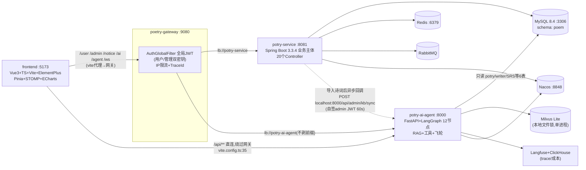

# 项目全景导览(ARCHITECTURE)

> 由 codebase-xray 全量探索生成于 2026-10-25。所有结论均带 `文件:行号` 证据(相对仓库根);
> 标注【推测】的为未完全实证项。配合阅读:`CLAUDE.md`(给 AI 会话的速查)、`docs/TECH-REPORT.md`(逐接口设计思路与主流对比)、`docs/READING-PATH.md`(重新认领路线)、`dev-notes/project-api-map.md`(既有 API 手记)。

## 1. 一句话定位

**诗词文化学习平台**「夜读」:Java 单体业务后端(potry-service)+ Python AI 伴学 Agent(potry-ai-agent)+ Vue3 前端,经 Spring Cloud Gateway 统一入口,按 dev-notes/ch01~ch08 章节推进的简历/面试项目,近期主要由 AI 代改(git 提交信息为证)。

## 2. 全局架构

要点:
- 网关路由 6 条(`poetry-gateway/src/main/resources/application.yml:25-53`):`/user /admin /notice /ai → lb://potry-service`;`/ws → lb:ws://potry-service`(STOMP 直通);`/agent → lb://potry-ai-agent`。**/agent 前缀不剥**,Agent 原生持有 `/agent/*` 路径(实证:`curl :9080/agent/health` 返回 FastAPI 风格 404,而 `:8000/health` 直连正常)。
- JWT 三个落点共用同一套密钥体系:网关 `AuthGlobalFilter.java:30-33`(第一道,验签后透传 `X-User-Id`)→ 后端拦截器 `WebMvcConfiguration.java:26-42`(第二道)→ Agent `auth.py:26-63`(读 header `token`,claims.userId)。用户端/管理端密钥物理隔离,均支持 legacy 密钥轮换。
- Agent 不经 HTTP 调 Java:直连共享 MySQL 只读 6 张表(`potry-ai-agent/db.py:10-78`);Java→Agent 仅一处 HTTP(导入回调);前端 `/api/**` 直连 :8000 绕过网关(有意设计,生产需保证可达)。

## 3. 模块地图(活/死判定)

| 模块 | 技术栈 | 规模 | 判定 | 一句话 |
|---|---|---|---|---|
| potry-service | Java17/SpringBoot3.3.4/MyBatis | 101 java | **活·主体** | 全部业务:用户/诗词/名句/诗人/诗坛/游戏/反馈/AI转发 |
| poetry-gateway | Spring Cloud Gateway | 4 java | **活** | 统一入口:JWT/限流/TraceId/CORS |
| poetry-common | Java | 40 java | **活**(仅 potry-service 依赖) | Result/PageResult、JwtUtil、RedisUtil、AliOss/WeChatPay 工具 |
| poetry-pojo | Java | 91 java | **活** | dto38/entity25/vo25,纯 Lombok,无 MyBatis-Plus 注解 |
| potry-ai | Java | 2 java | **死模块** | hello world+注释类,无人依赖(证据见 §9) |
| potry-ai-agent | Python/FastAPI/LangGraph | 124 py | **活·新一代AI** | 编排对话/RAG/工具/MCP/飞轮/成本报表,pytest 423 全绿 |
| frontend | Vue3/TS/Vite | 46 文件 | **活** | 用户端 12 页 + 管理控制台 2 页 |

分层:实体在 poetry-pojo(`com.fuze.entity`),业务在 potry-service(`controller/{admin,user,Ai} + service(+impl) + mapper + config + task + mq`)。

## 4. 入口点汇总

### 4.1 后端 REST(20 个 @RestController,8081)
- 管理端:`/admin`(登录/验证码/用户治理)、`/admin/potry`(诗词CRUD)、`/admin/rhesis`、`/admin/writer`、`/admin/blog`(帖子/评论管理)、`/admin/log`、`/admin/command`
- 用户端:`/user`(27端点:登录注册/个人信息/收藏/诗集本)、`/user/poetry`(27端点:诗词检索/AI出题 query 与 query/end)、`/user/rhesis`、`/user/writer`、`/user/Comment`、`/user/luntan`(17端点)、`/user/FeedBack`、`/user/game`(8)、`/user/AI`、`/user/AI/draow`、`/ai`(旧AI:sbuat/chat11/audio/picture)、`/notice`
- **无鉴权裸路由**:~~/aiaiaai、/aiaiaaiddddddd~~(已于 2026-10-25 随旧 AI 孤岛整删)、/actuator/*、STOMP /ws;~~/build/bulid~~ 已删除。风险面见 §7。
- 逐端点明细:见各 Controller(`potry-service/src/main/java/com/fuze/potryservice/controller/**`)

### 4.2 后端异步入口
- STOMP:`/ws` 端点(`config/WebSocketConfig.java:18-27`),推送 `/topic/newpost`(mq/PostNotifyListener.java:78)、`/topic/review.{userId}`(task/ReviewRemindTask.java:73)
- RabbitMQ 消费:`post.notify.queue`(post.exchange/post.created,带 DLX;mq/PostNotifyListener.java:38-44)+ 死信消费(:90-99)
- 定时:每日9:00 复习提醒(task/ReviewRemindTask.java:38)+ 每20s MQ 补偿重投(service/impl/PoemLunTanServiceimpl.java:457-460)

### 4.3 Agent 端点(8000)
| 方法 路径 | 职责 |
|---|---|
| POST /agent/workflow | **主编排入口**(SSE,thread_id=sessionId) |
| POST /agent/workflow/resume | interrupt 确认/取消 |
| POST /agent/chat | 旧单轮 Function Calling SSE(与 workflow 并存) |
| POST /agent/feedback、/agent/feedback/negative、/agent/correction | 反馈/纠错(喂飞轮) |
| GET /api/conversations[/{id}/messages] | 会话侧栏/回载 |
| GET/POST /api/admin/review[/approve,/reject] | 飞轮待审 |
| GET /api/admin/cost、/api/admin/audit | 成本报表/工具审计 |
| GET/POST /api/admin/kb/syncstats、/api/admin/kb/sync | 知识库对账/同步 |
| GET /health、/nav、/chat、/admin/* 静态页 | 探针与运维页 |

### 4.4 前端路由(`frontend/src/router/index.ts:7-21`)
/poetry 诗词库 · /poem/:title 详情 · /writers 诗人 · /rhesis 名句 · /forum 诗坛 · /review 今日复习 · /feedback · /notice · /center 个人中心 · /ai 青莲Agent · /console 与 /console/content(管理,**路由层 public,仅组件内登录门**)· /login

## 5. 五条核心链路(端到端实证)

### 链路1 读诗(含缓存)
1. `PoetryList.vue` → `api/poetry.ts` → axios 实例(`utils/request.ts`,token 注入,401 清 token 跳登录 :47-53)
2. vite 代理 `/user` → `:9080`(frontend/vite.config.ts:19-38)
3. 网关 `AuthGlobalFilter` 验用户 JWT → `lb://potry-service`(gateway application.yml:25-31)
4. `PoetryController`(`controller/user/PoetryController.java`)→ PotryMapper(MySQL potry 表);热搜走 Redis `woko:{id}`(:408-410,Redisson 与 StringRedisTemplate **双客户端双写同一 key**,疑点)
5. 返回统一 `Result` 包装(poetry-common/result/Result.java:18)

### 链路2 AI 对话(主编排,SSE)
1. `AiChat.vue:167` 原生 fetch POST `/agent/workflow`(流式读取)
2. vite 代理 → 网关验 JWT → Agent(不剥前缀)
3. `main.py:544` → `resolve_user_id` 验签(auth.py:26-63)→ 409 检查未决 interrupt(main.py:549-555)→ Langfuse trace
4. LangGraph 12 节点(workflow/graph.py:63-102):resolve(指代消解)→ classify(八类意图)→ route → 知识类 retrieve(三源召回+MySQL 回查)→ gate(置信度闸 0.46 阈值)→ agent;判定类 slot_check(槽位+点选卡片)→ expand_query → retrieve_policy → agent;→ log(落库+层2摘要投递)
5. agent 节点 ReAct 子循环(agent_react.py):bind_tools → tool_node(统一 ToolCatalog+审计)→ 写工具 create_ticket 经 **ticket_confirm interrupt**(nodes.py:292-311),前端 POST /agent/workflow/resume 放行
6. 状态持久化:AsyncSqliteSaver(checkpoints/graph.sqlite),thread_id=sessionId
7. 流式输出(2026-10-26 已改造为真流式):`astream_events` 事件流直驱——agent 节点 LLM delta 实时转 token 帧、工具执行实时转 tool_status 帧(calling→done),trace/action 帧图结束后从最终状态补发;实测帧序 `meta → tool_status* → token* → trace → done`,首 token 从"全图跑完"提前至前置链路完成(实测 6.2~7.9s / 总 8.8~10.2s);config 全链透传(agent→LLM、tool_node→engine→BaseTool)是事件流生效前提;测试替身等无 astream_events 的装配自动回退伪流式(旧帧序契约保留)

### 链路3 发帖实时推送(MQ→STOMP)
1. `Forum.vue` 发帖 → `/user/luntan/fabutiezi` → `PoemLunTanServiceimpl.java:76` 发 `post.exchange`/`post.created`
2. `PostNotifyListener.java:38-44` 消费(声明式绑定+DLX)→ `:78` STOMP 推 `/topic/newpost`
3. `Forum.vue:210-230` 订阅 `/topic/newpost` → toast+刷新第一页
4. 失败兜底:死信队列(:90-99)+ 每20s 补偿重投(PoemLunTanServiceimpl.java:457-460、469)

### 链路4 背诵/SRS 闭环(艾宾浩斯)
1. 建书 `book/add` → 加诗 `book/addpoem` → 开始 `book/start` 生成排期(userbook/userbookpoem/userlearningschedule 表)
2. 每日 9:00 `ReviewRemindTask.java:38` cron → `GetDueReviewUsers` → Redis 批次锁 `remind:lock:{date}` + 用户级防重 `remind:sent:{date}:{userId}` → STOMP `/topic/review.{userId}`(:73)+ ZSet 提醒日志(留7条)
3. `reviewRemind.ts:12-43` 全局订阅 → ElMessage toast;管理端可手动触发 `/admin/remind/trigger`(Admin RemindTask trigger(force))
4. 用户完成背诵 → `GET /user/poetry/query/end?kk=1&poemid`(PoetryController.java:435-437)推进 1/3/7/14/30 天轮次
5. 今日任务 `GET /user/book/today`(UserController.java:334-336)

### 链路5 知识库同步(MySQL→Milvus)
1. 管理台导入诗词 `/admin/potry/add` → `PotryController.java:50-60` 入库 → `notifyKbSync`(:64-79)`CompletableFuture.runAsync` 异步:自签 admin JWT(60s,userId=1)→ `POST http://localhost:8000/api/admin/kb/sync?title=...`
2. Agent `kb_sync_api.py:170`:按诗切块(400字/重叠60,chunking.py:75-100)→ BGE-M3 1024 维(onnx 引擎)→ Milvus collection `knowledge` upsert → mark_embedded(build_kb.py:126-154)
3. 对账:`GET /api/admin/kb/syncstats`(potry_total vs covered/pending/embedded);无参全量同步清孤儿向量;失败不阻塞导入
4. 检索消费:对话链 retrieve 节点三源召回(poem/poet/qa)后回查 MySQL 原文

## 6. 数据模型(schema `poem`,~21 张表)

**Java 写**:user、admin、potry(诗词)、writer、rhesis(名句)、comment、forum_comment、poem_blog、blog_like、comment_like、notice、feedback(列名 `messsage` 拼写错误系原样沿用)、gamerank、questionsgame、suggestion、airole、userbook、userbookpoem、usercollectionpoem、userlikerhesis、tb_follow
**Agent 写**:conversations、messages、conversation_summaries、feedback(复用 Java 表)/corrections/tickets/tool_audit_logs(app_storage.py)、knowledge_chunks/knowledge_mining_cursor/review_queue/pending_questions(knowledge.py 等)
**Agent 只读**:potry、writer、userbook、userbookpoem、userlearningschedule、usercollectionpoem(db.py:10-78)

实体 POJO 在 `poetry-pojo/com.fuze.entity|dto|vo`;MyBatis XML 仅 7 份(resources/Mapper/),其余约 170 处注解 SQL。

## 7. 风险与疑点清单(按严重度)

### P0 安全
1. ~~**`/build/bulid` 裸路由可 DROP 整库**~~ **已修复(2026-10-25)**:buildSqlController 整体删除(全仓零调用方),路由已 404;`resources/sql/` 转储文件保留,重建库请手动执行。
2. ~~**`/aiaiaai`、`/aiaiaaiddddddd` 裸路由调付费 AI**~~ **已修复(2026-10-25)**:整个旧 AI 孤岛删除(11 个文件:config/OPTIONS/Chat、controller/Ai/ 全部 6 类、user/AiController、MyWebSocketHandler、SseEmitterXIUGAI、ApiService+impl),前端零调用、内部闭环引用。
3. ~~**硬编码密钥散布**~~ **已修复(2026-10-25)**:随孤岛删除消掉讯飞×2/绘画/spark 四处;余下密钥(Spring AI key、QQ 邮箱授权码、MySQL 密码、MQ 账号、JWT 双密钥、阿里云 AK/SK)统一迁入 **`application-secret.yml`(service 与 gateway 各一份,已 gitignore)**,主配置只留 `${ENV:}` 占位;RabbitMQConfig 的硬编码连接串改为 @Value 注入。**注意:secret 文件键名对齐配置里的环境变量占位(JWT_USER_SECRET 等),克隆后必须重建该文件或注入环境变量,否则服务起不来/连不上。**
4. ~~**Agent 鉴权默认宽松**~~ **已加固(2026-10-25)**:① 网关 `USER_PROTECTED` 补上 `/agent/**`(AuthGlobalFilter.java:40)——经网关的 Agent 流量强制用户 JWT,伪造 token/无 token 均 401;② `/api/conversations*` 改为 `resolve_user_id` 验签优先(main.py),无身份一律 401(旧的"不带 userId 返回全部会话"匿名洞已封);③ `AUTH_STRICT=1` 仍保留为可选生产开关(.env),默认关闭以兼容 evals 验收脚本与 static 演示页的直连遗留模式。残余暴露面:直连 :8000 的无 token 请求仍可伪造 userId(仅本机),生产部署时开 strict 即可闭合。
5. **水平越权面**:反馈删除/管理员回复挂 `/user/FeedBack`(FeedBackController.java:69-104)、游戏记录删除 `/user/game/delete/{id}`(QuestionGameController.java:148)仅用户 token 即可调。
6. **管理台前端裸奔**:`/console*` 路由 meta.public(router/index.ts:19-20),AppNav.vue:20 对所有登录用户展示入口,仅组件内 v-if 挡(靠后端 401 兜底);STOMP `/ws` 无鉴权。

### P1 正确性/依赖
7. ~~requirements.txt 缺运行时硬依赖~~ **已修复(2026-10-25)**:PyJWT 2.15.1 / langfuse 5.0.4 / onnxruntime 1.31.0 / requests 2.34.2 已按 venv 实装版本钉入;未使用的 modelscope 已移除。
8. 断头 SQL:`UPDATE your_table` 占位(Mapper/UserMapper.xml:14-22)、`updachatId` 无效 SQL(mapper/UserMapper.java:39-40)。
9. 计分可作弊:score() 信任前端传 userId(QuestionGameController.java:105);单例字段 sum 并发串分(:42,:89);`if(false)` 永假分支(:65-67)。
10. 两代实现并存:Agent `/agent/chat`(内存+旧 ToolRegistry)vs `/agent/workflow`(三层上下文+ToolCatalog);后端 PageHelper 双 PageInterceptor 注册(MyBatisConfig.java:16-34)而 yml 配置无效;Redisson/StringRedisTemplate 同 key 双写。
11. 前端 **38 个死 API 函数**(user.ts 9、forum.ts 9、feedback.ts 5、notice.ts 4、poetry.ts 4、writer.ts 5、rhesis.ts 2)——ai.ts(10)与 comment.ts(5)两个整文件及其 vite 死代理已于 2026-10-25 清理;对应的后端旧端点大多还活着,属"AI 改造后未回收的旧方案"。
12. 契约不符示例:`@ApiOperation("批量删除帖子")` 标在 GET /comments(admin CommentController.java:39-41);GET /user/forget 用 @RequestBody(UserController.java:154-156);`"user/comment"` 缺前导斜杠→实际 /user/user/comment(UserController.java:351)。

### P2 卫生
13. 幽灵配置:spring.websocket.stomp/sockjs、data.redisson.config、logging.level.com.fuze.mapper(包名写错匹配不到)、pagehelper.*(非 starter,真实配置在 MyBatisConfig)——application.yml 四组键无人读。
14. @EnableCaching + spring-boot-starter-cache 但全工程零 @Cacheable;springfox 2.7.0 与 Boot3 不兼容(/doc.html 落空);h2 依赖+data/*.mv.db 遗留;fastjson 根属性 1.2.76/1.2.83 双声明且均未被引用(实际用模块硬编码 1.2.83);根 pom mainClass com.nhky.MainClass 指向不存在的类。
15. 仓库垃圾:根目录 7 个 build*.log、run-*.log、4 个 hs_err 崩溃日志、3 个 mp3、练手 java(k/koko/text11/ab/LRUCache/TheadLocal 等,git 跟踪但零引用)、`-m` 与 standalone/ 空目录、out/ IDEA 编译残留、data/testload.mv.db(H2 文件被 git 跟踪)、模块内 5 个 .vue.bak、application.yml.bak、potry-service 内 4 个 hs_err、根 pom 被整段注释的依赖三处。
16. 死代码(后端):StudyController 空类、InteractiveController 全注释、ApiService(impl 写死 example.com)、AsyncService.asyncNotifyFans(被 MQ 替代)、MyWebSocketHandler(从未注册)、kkk 队列拓扑、根包练习题类;73 处 System.out 与 slf4j 并存;groovy.util.logging.Slf4j 误导入(RhesisCOntroller.java:7)。
17. 命名:`potry` vs `poetry` 两种拼写并存(模块名/服务名/类名);`RhesisCOntroller` 大小写;vo 大小写混乱(BlogVO vs BlogUserVo);搜代码时两种拼写都要试。

### 二轮深挖补充(2026-10-25 方法级考古,详见 TECH-REPORT.md)
18. 🔴 `/agent/workflow/resume` 无鉴权(仅凭 sessionId 可操作他人工单);Vue AiChat 未实现 confirm_ticket→resume 链路,Vue 用户遇建单确认即 409 卡死
19. 🔴 `/admin/potry/delete` 前后端契约不符(前端发 query 后端要 body)→删除功能实际必 400;rhesis/writerDelete 疑似同病(ids[] 序列化)
20. 🔴 `/admin/login/code` 响应体回显验证码;`/agent/feedback/negative`、`/agent/correction` 无验签;`/agent/chat` 验签结果被丢弃
21. 🟡 login `System.out.println(password)`;`/user/forget` GET+body 不可用;`select/guanzhu` 判空反转致关注流失效
22. 🟡 AI 出题链残缺(query 死接口,query/end 恒 kk=1 无判题,`woko:{id}` 死 key 双写);AICommand LLM 直驱删库设计(死接口)
23. 🟡 全项目死接口 ≈70/150:/user/Comment 全组、/user/game 全组、/user/poetry 诗人类 16 个;点赞幂等(dianzan)反而是亮点样板

## 8. 运行验证记录(2026-10-25 20:35~20:45;同日 21:30~21:50 二轮)

- **冒烟(全栈当时在线)**:`:8000/health` UP;`:8081/actuator/health` UP;`:9080/notice/getList` HTTP 200(**网关→服务→MySQL 全链通**);Nacos :8848 200;Vite :5173 200;`:9080/agent/health` 返回 FastAPI 404(不剥前缀的拓扑证据,非故障)。
- **Agent 测试**:`pytest -q` → **423 passed**(48s,离线;警告:test JWT key 14 字节过短、nacos ssl 弃用、Langfuse 无凭据 no-op)。
- **前端测试**:`vitest run` → **8 passed**(3 文件:守卫/store/AgeTabs,4.8s,零网络依赖)。
- **Java**:src/test 仅 1 个 `@SpringBootTest contextLoads` 且无断言、需全套真实中间件 → 未执行。构建/运行证据:potry-service jar 构建于当日 19:36、gateway 15:33,run-java.log/run-gw.log 当日 20:19 仍在更新,服务实跑。
- **测试质量梯度**:Agent 423 离线用例(好)≫ 前端 8 例(浅)≫ Java 0 有效用例(裸奔)。

### 二轮验证(P0 修复后,21:30~21:50)

- 重打包+重启三服务后 `pytest` 需更新 3 个会话 API 契约用例(匿名拉列表→401)→ **423 passed**(66s)。
- 安全断言:网关 `/agent/workflow` 无 token/伪造 token → **401/401**;Agent `/api/conversations` 无身份 → **401**;`?userId=` 遗留兼容 → 200;`/aiaiaai`、`/build/bulid` → **404/404**。
- 真实 JWT 端到端(用 .env 密钥签发):网关 `/user/poetry/GetCount` → **200**;网关 `/agent/workflow` → **200**;无 token → 401;白名单 `/admin/getCode`、`/notice/getList` → 200。
- 踩坑记录:①dev profile 的 yml 与非 profile 的 secret 文件同名键冲突时 profile 胜出 → secret 文件键名改用环境变量名(`JWT_USER_SECRET` 等)对齐占位符后解决;②网关首版漏加 `spring.config.import` 导致空密钥验签全 401,已补;③Git Bash 直接调 `cmd start` 会路径转义损坏,须经临时 bat。

## 9. 遗留物判定(可清理项)

| 项 | 证据 | 处置建议 |
|---|---|---|
| potry-ai 模块 | 仅 Main.java:4-6 hello world + 全注释的 CreateArkClientExample;全仓无依赖(grep "potry-ai" 仅根 pom:97 与自身) | 从根 pom `<modules>` 移除 |
| 根 src/main | 空目录 | 删 |
| 根 pom mainClass | com.nhky.MainClass 全仓不存在 | 删 jar-plugin mainClass 配置 |
| 练手 java × 10+ | k.java、koko.java、text11.java、ab.java、LRUCache.java(0 字节)等,零引用 | 移出仓库或归档 |
| 日志/崩溃转储 | build*.log ×7、run-*.log ×8、hs_err ×8 | 删+进 .gitignore |
| mp3 ×5 | 2024-10 生成产物 | 删 |
| `-m`、standalone/ | 空目录(`-m` 疑似命令行误创建) | 删 |
| out/、work/、data/ | IDEA 编译输出/SQL 脚本/H2 库(testload.mv.db 被 git 跟踪) | 删或 gitignore |
| *.vue.bak ×5、application.yml.bak、sql/*.bak | 备份文件 | 删(git 有历史) |
| .superpowers/ | brainstorm mockup ×9 | 按需保留(有 docs/superpowers 设计文档) |
| naive_agent.py、evals/ | 生产不加载,有意保留的教学对照与联机验收 | **保留**,勿清理 |
