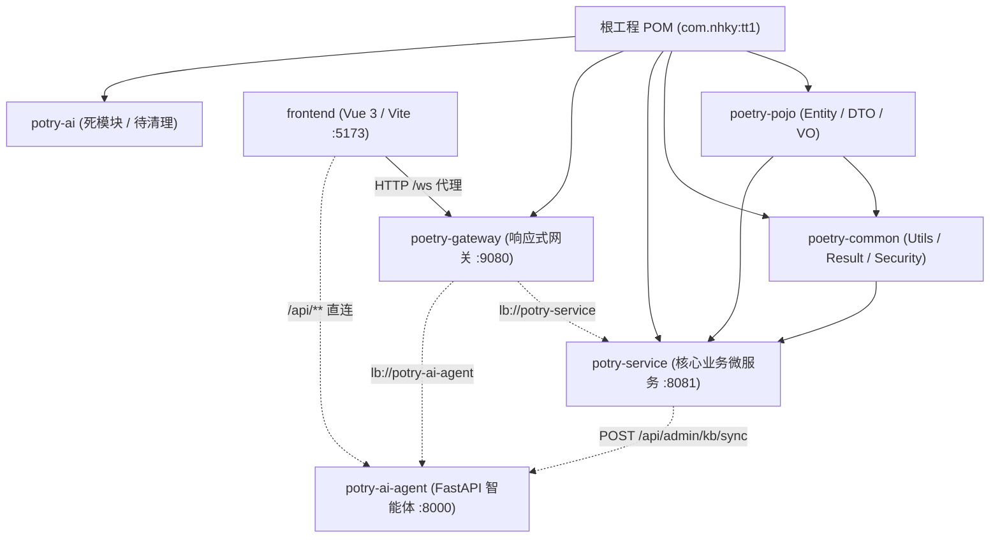

# poetry-spring2 全系统技术架构深度梳理与代码质量分析报告

> **报告版本**：v1.0.0 (Release)  
> **归档路径**：`E:\javatexts\poetry-spring2\docs\PROJECT_ANALYSIS_REPORT.md`  
> **报告作者**：Teamwork Technical Audit & Engineering Group  
> **基线代码**：`E:\javatexts\poetry-spring2`  
> **分析日期**：2026-10-29  
> **审计范围**：后端核心服务 (`potry-service` / `poetry-common` / `poetry-pojo`)、API 网关 (`poetry-gateway`)、AI 伴学智能体 (`potry-ai-agent`)、前端工程 (`frontend`)、性能压测与基准体系 (`docs/bench`)、核心指标履约方案 (`dev-notes/resume-metrics-plan.md`)、启停运维脚本与周边依赖拓扑 (`start-all.bat` / `stop-all.bat` / MySQL / Redis / Nacos / RabbitMQ / Observability)。

---

## 报告导航目录

- [第一章 执行概要与整体系统架构视图](#第一章-执行概要与整体系统架构视图)
  - [1.1 业务背景与系统战略定位](#11-业务背景与系统战略定位)
  - [1.2 全局物理与逻辑微服务拓扑](#12-全局物理与逻辑微服务拓扑)
  - [1.3 核心通信协议与服务接口矩阵](#13-核心通信协议与服务接口矩阵)
  - [1.4 端到端全局数据流向与跨服务协同](#14-端到端全局数据流向与跨服务协同)
- [第二章 仓库组织与工程结构深度解析](#第二章-仓库组织与工程结构深度解析)
  - [2.1 根 POM 继承体系与多模块构建规范](#21-根-pom-继承体系与多模块构建规范)
  - [2.2 BOM 依赖仲裁与版本管理冲突治理](#22-bom-依赖仲裁与版本管理冲突治理)
  - [2.3 模块依赖流向矩阵与边界治理](#23-模块依赖流向矩阵与边界治理)
  - [2.4 历史遗留与死模块剖析 (potry-ai)](#24-历史遗留与死模块剖析-potry-ai)
  - [2.5 仓库根目录杂物与构建产物堆积审计](#25-仓库根目录杂物与构建产物堆积审计)
- [第三章 后端核心服务架构与深度业务领域](#第三章-后端核心服务架构与深度业务领域)
  - [3.1 架构分层剖析与组件职责拓扑](#31-架构分层剖析与组件职责拓扑)
  - [3.2 诗词语料与多维检索域深度设计 (ngram vs LIKE)](#32-诗词语料与多维检索域深度设计-ngram-vs-like)
  - [3.3 用户认证、账号治理与艾宾浩斯记忆域 (SRS)](#33-用户认证账号治理与艾宾浩斯记忆域-srs)
  - [3.4 社区论坛与文坛互动域 (事务钩子、推模式收件箱、两段式评论)](#34-社区论坛与文坛互动域-事务钩子推模式收件箱两段式评论)
  - [3.5 智能体代理与指令中枢域 (AI 自然语言动作解析与增量同步)](#35-智能体代理与指令中枢域-ai-自然语言动作解析与增量同步)
- [第四章 存储、持久化与多级缓存体系架构](#第四章-存储持久化与多级缓存体系架构)
  - [4.1 MySQL 8.4 数据库模式与表结构全景 (25张表)](#41-mysql-84-数据库模式与表结构全景-25张表)
  - [4.2 关键索引体系优化与慢查询治理](#42-关键索引体系优化与慢查询治理)
  - [4.3 Redis 三防护与韧性缓存设计 (穿透/击穿/雪崩)](#43-redis-三防护与韧性缓存设计-穿透击穿雪崩)
  - [4.4 随机推荐 ID 池 (RandomIdPool) 架构革新](#44-随机推荐-id-池-randomidpool-架构革新)
  - [4.5 Redis 30+ 业务键拓扑与数据结构全景表](#45-redis-30-业务键拓扑与数据结构全景表)
- [第五章 API 网关路由、安全隔离与流量控制](#第五章-api-网关路由安全隔离与流量控制)
  - [5.1 Netty 响应式内核与网关路由定义](#51-netty-响应式内核与网关路由定义)
  - [5.2 全局过滤器执行链路与执行序](#52-全局过滤器执行链路与执行序)
  - [5.3 双 JWT 角色物理隔离与平滑轮换机制](#53-双-jwt-角色物理隔离与平滑轮换机制)
  - [5.4 Redis 响应式令牌桶限流与 IP 解析](#54-redis-响应式令牌桶限流与-ip-解析)
  - [5.5 网关层缺陷、缺失机制与安全盲区](#55-网关层缺陷缺失机制与安全盲区)
- [第六章 Python AI 伴学智能体服务与确定性编排](#第六章-python-ai-伴学智能体服务与确定性编排)
  - [6.1 运行时选型与 Nacos 心跳保活机制](#61-运行时选型与-nacos-心跳保活机制)
  - [6.2 LangGraph 12 节点确定性 DAG 图编排架构全解](#62-langgraph-12-节点确定性-dag-图编排架构全解)
  - [6.3 ReAct 子循环与三元工具系统 (内置/插件/MCP)](#63-react-子循环与三元工具系统-内置插件mcp)
  - [6.4 人机协同 (HITL) 与敏感工单中断恢复机制](#64-人机协同-hitl-与敏感工单中断恢复机制)
  - [6.5 三层分级上下文压缩与 Token 预算数学模型](#65-三层分级上下文压缩与-token-预算数学模型)
  - [6.6 RAG 与本地向量引擎 (Milvus Lite & BGE-M3 ONNX 加速)](#66-rag-与本地向量引擎-milvus-lite--bge-m3-onnx-加速)
  - [6.7 知识飞轮自愈数据闭环 (负反馈、去重与审批)](#67-知识飞轮自愈数据闭环-负反馈去重与审批)
  - [6.8 真实流式响应 (SSE) 机制与帧序契约](#68-真实流式响应-sse-机制与帧序契约)
- [第七章 前端工程结构与沉浸式交互实现](#第七章-前端工程结构与沉浸式交互实现)
  - [7.1 技术栈与现代构建配置 (Vue 3 + Vite + TS)](#71-技术栈与现代构建配置-vue-3--vite--ts)
  - [7.2 状态管理双 Store 架构 (useUserStore vs useAdminStore)](#72-状态管理双-store-架构-useuserstore-vs-useadminstore)
  - [7.3 网络请求层双 Axios 实例与拦截器规范](#73-网络请求层双-axios-实例与拦截器规范)
  - [7.4 Vite 开发代理与路由映射避坑设计](#74-vite-开发代理与路由映射避坑设计)
  - [7.5 核心视图交互流程与创新组件剖析](#75-核心视图交互流程与创新组件剖析)
- [第八章 压测基准体系与性能指标真实性验证](#第八章-压测基准体系与性能指标真实性验证)
  - [8.1 压测工具矩阵与技术选型 (JMeter CLI / Python)](#81-压测工具矩阵与技术选型-jmeter-cli--python)
  - [8.2 核心测试场景与性能指标提升全景数据矩阵](#82-核心测试场景与性能指标提升全景数据矩阵)
  - [8.3 压测方法论与统计口径割裂核实 (服务端 P95 vs 客户端 P95)](#83-压测方法论与统计口径割裂核实-服务端-p95-vs-客户端-p95)
  - [8.4 利特尔法则与 HikariCP 连接池硬顶瓶颈推导](#84-利特尔法则与-hikaricp-连接池硬顶瓶颈推导)
- [第九章 核心简历指标方案与代码实现差异分析](#第九章-核心简历指标方案与代码实现差异分析)
  - [9.1 21 项技术优化方案代码级逐一核验矩阵](#91-21-项技术优化方案代码级逐一核验矩阵)
  - [9.2 深度 Gap Analysis (代码现状 vs 简历声称客观边界)](#92-深度-gap-analysis-代码现状-vs-简历声称客观边界)
- [第十章 启动运维、服务编排与周边外部依赖协同](#第十章-启动运维服务编排与周边外部依赖协同)
  - [10.1 启动时序与健康探测编排 (start-all.bat)](#101-启动时序与健康探测编排-start-allbat)
  - [10.2 逆序优雅关机与存储防护 (stop-all.bat)](#102-逆序优雅关机与存储防护-stop-allbat)
  - [10.3 全系统端口分配与运行形态速查表](#103-全系统端口分配与运行形态速查表)
  - [10.4 Nacos 多语言混合注册与 Python 独立心跳守护](#104-nacos-多语言混合注册与-python-独立心跳守护)
  - [10.5 监控与全栈可观测性体系 (Actuator + Prometheus + Grafana + MDC TraceId)](#105-监控与全栈可观测性体系-actuator--prometheus--grafana--mdc-traceid)
  - [10.6 关于 SkyWalking 与 MySQL 8.4 保护策略的客观定性](#106-关于-skywalking-与-mysql-84-保护策略的客观定性)
- [第十一章 代码质量、设计模式、坏味道与重大安全风险评估](#第十一章-代码质量设计模式坏味道与重大安全风险评估)
  - [11.1 设计模式落地典范与架构亮点](#111-设计模式落地典范与架构亮点)
  - [11.2 P0 级严重高危漏洞 (云厂商 AK/SK 泄露、验证码回传、垂直越权)](#112-p0-级严重高危漏洞-云厂商-aksk-泄露验证码回传垂直越权)
  - [11.3 P1 级严重并发与逻辑缺陷 (单例成员污染、ThreadLocal 泄漏、逻辑取反)](#113-p1-级严重并发与逻辑缺陷-单例成员污染threadlocal-泄漏逻辑取反)
  - [11.4 代码坏味道、反模式与维护性缺陷](#114-代码坏味道反模式与维护性缺陷)
- [第十二章 可落地的架构演进与重构路线图](#第十二章-可落地的架构演进与重构路线图)
  - [12.1 阶段一：P0 紧急安全阻断与认证合规治理 (1-3天)](#121-阶段一p0-紧急安全阻断与认证合规治理-1-3天)
  - [12.2 阶段二：P1 并发修复、功能自愈与稳定性加固 (1周)](#122-阶段二p1-并发修复功能自愈与稳定性加固-1周)
  - [12.3 阶段三：P2 架构韧性、高可用演进与规范化建设 (2-4周)](#123-阶段三p2-架构韧性高可用演进与规范化建设-2-4周)
- [总结与结论](#总结与结论)

---

## 第一章 执行概要与整体系统架构视图

### 1.1 业务背景与系统战略定位

`poetry-spring2` 是一个以中国古典诗词文化为核心背景、面向现代互联网用户的高性能数字化学习、交流与 AI 伴学平台。系统立足于解决传统传统文化学习类应用检索性能差、社交交互高并发易超发、记忆排期无规划以及大模型问答幻觉频发、上下文计费不可控等一系列业界经典难题。

系统业务矩阵涵盖：
1. **百万字级诗词语料检索与赏析**：基于 MySQL 8.0 `ngram` 全文索引构建秒级精确检索，集成基于 Redis 的随机诗词/名句抽样推荐。
2. **艾宾浩斯间隔重复遗忘曲线学习系统 (SRS)**：为背诵用户定制 1/3/7/14/30 天科学记忆梯度，依托 MySQL 8.0 窗口函数优化排期算法，配合 WebSocket STOMP 定时精准推送复习提醒。
3. **文坛社交社区与互动 Feed 流**：构建基于事务一致性（`afterCommit`）的 RabbitMQ 异步可靠发帖通知、粉丝推模式收件箱、原子防刷点赞（Redis ZADD + MySQL 联合主键明细事实源自愈）以及两级拍扁评论盖楼。
4. **多角色 AI 诗人伴学大脑**：基于 Python FastAPI + LangGraph 1.2+ 构建确定性状态图编排工作流，打通 Milvus Lite 嵌入式向量知识库（BGE-M3 ONNX 推理加速），集成 Model Context Protocol (MCP) 工具扩展，打造具象化古典人物伴读体验。

---

### 1.2 全局物理与逻辑微服务拓扑

系统呈现为 **"Spring Cloud Gateway 统一边缘接入 + Spring Boot 业务单体集群 + Python FastAPI 智能体伴学微服务 + Vue 3 沉浸式古典美学前端 + 分布式中间件矩阵"** 的异构混合微服务架构。

```
                                  +-------------------------------------------------------------+
                                  |                 Frontend Client (Port 5173)                 |
                                  |        Vue 3.4 + Vite 5.4 + Pinia 3.0 + Element Plus 2.8    |
                                  |            STOMP WebSocket Client + SSE Stream Reader       |
                                  +-------------------------------------------------------------+
                                         | (RESTful HTTP / STOMP WS)               | (/api/** Agent 直连)
                                         v                                         v
+-------------------------------------------------------------------+    +------------------------------------+
|                    poetry-gateway (Port 9080)                     |    |     potry-ai-agent (Port 8000)     |
| - Netty Reactive 非阻塞事件循环驱动                                |    | - Python 3.11+ / FastAPI / Uvicorn |
| - TraceIdGlobalFilter (生成/透传 16位 X-Trace-Id, Order: -2^31)   |    | - LangGraph 1.2+ 12节点确定性工作流  |
| - AuthGlobalFilter (双密钥隔离: Admin vs User, Order: -100)       |    | - Milvus Lite (AUTOINDEX / COSINE) |
| - RequestRateLimiter (Redis 令牌桶: replenish=2000, burst=4000)   |    | - ONNX Runtime 驱动 BGE-M3 嵌入    |
| - 静态路由转 Nacos 动态发现 (lb://potry-service, lb:ws://)        |    | - Nacos 实例注册 + 5s 独立心跳守护 |
+-------------------------------------------------------------------+    | - Prometheus /metrics 延迟直方图   |
          | (lb://potry-service)                 | (lb:ws://)            +------------------------------------+
          v                                      v                                 ^              ^
+-------------------------------------------------------------------+              |              |
|                     potry-service (Port 8081)                     |              |              |
| - Spring Boot 3.3.4 + Java 17 + Tomcat (max=200, accept=200)      |              |              |
| - Interceptors (JwtTokenUserInterceptor / AdminInterceptor)       |              |              |
| - Business Domains: Poetry / PoemLunTan / QuestionGame / User     |              |              |
| - Cache Strategy: 3-Tier Protection, Logical Expiration, IdPool   |              |              |
| - Task Scheduler: ReviewRemindTask (09:00 Cron + 分布式批次锁)    |              |              |
| - Actuator & Micrometer Prometheus Registry                       |              |              |
+-------------------------------------------------------------------+              |              |
     |                     |                    |                   |              |              |
     | (JDBC/HikariCP 20)  | (Lettuce 500ms)    | (AMQP 0-9-1)      +-- 异步 HTTP 增量同步通知 ----+
     v                     v                    v                   |   (POST /api/admin/kb/sync) |
+------------------+  +------------------+  +-------------------+   |                             |
| MySQL 8.4 Server |  |   Redis 7.x      |  | RabbitMQ 3.3.4    |   |                             |
| (Port 3306)      |  | (Port 6379)      |  | (Port 5672/15672) |   |                             |
| - Schema: poem   |  | - 30+ 业务键拓扑 |  | - post.exchange   |   |                             |
| - 10,778 诗词表  |  | - Set 随机抽样池 |  | - post.notify.q   |   |                             |
| - 10,001 名句表  |  | - 逻辑过期互斥锁 |  | - post.dlx (死信) |   |                             |
| - 25 张业务表    |  | - ZSet 收件箱/赞 |  | - 3次指数重试     |   |                             |
+------------------+  +------------------+  +-------------------+   |                             |
         ^                     ^                      |             |                             |
         |                     |                      v             |                             |
         |                     |             +--------------------+ |                             |
         |                     |             | PostNotifyListener | |                             |
         |                     |             | - 粉丝收件箱落库   | |                             |
         |                     |             | - 详情预热缓存     | |                             |
         |                     |             | - STOMP 广播全站   |-+                             |
         |                     |             +--------------------+                               |
         |                     |                                                                  |
         +---------------------+------- 只读共享 6 张业务表 (potry, writer, SRS等) ---------------+
                               |
+-------------------------------------------------------------------------------------------------+
| 可观测性支撑栈 (Observability Stack)                                                             |
| - Prometheus 2.54.1 (Port 9091) -> Grafana 11.3.0 (Port 3001)                                   |
| - 日志 TraceId 贯通: MDC [%X{traceId:-}] -> HTTP Header -> MQ Header -> Consumer MDC           |
| - AI 追踪平台: Langfuse (Port 3000 / 9090)                                                      |
+-------------------------------------------------------------------------------------------------+
```

---

### 1.3 核心通信协议与服务接口矩阵

各组件间严格定义并遵循了标准化的网络通信协议：

| 通信链路 | 源节点 | 目标节点 | 应用层协议 / 传输层 | 鉴权机制与核心契约 |
|---|---|---|---|---|
| **API 统一入口** | Frontend | Gateway (:9080) | HTTP/1.1 RESTful (JSON) | Header 携带 `token`；双密钥隔离解析 |
| **实时长连接** | Frontend | Gateway -> Service | WebSocket / STOMP (`/ws`) | 原生透传握手；订阅 `/topic/newpost` 与 `/topic/review.{uid}` |
| **AI 伴学流** | Frontend | Agent / Gateway | HTTP/1.1 SSE (text/event-stream) | Query 或 Header 传 Token；分块传输 `token`, `tool_status`, `trace` 帧 |
| **网关服务分发** | Gateway | Service / Agent | Netty Reactive HTTP Client | Nacos 动态实例寻址；自动透传 `X-Trace-Id` 与 `X-User-Id` |
| **持久层访问** | Service | MySQL (:3306) | MySQL Client/Server Protocol (TCP) | HikariCP 连接池管理；MySQL 8.0 `caching_sha2_password` |
| **缓存与状态** | Service / GW | Redis (:6379) | Redis RESP 协议 (TCP) | Lettuce (Spring Boot) / Jedis (Redisson) 响应式驱动 |
| **异步消息驱动**| Service | RabbitMQ (:5672) | AMQP 0-9-1 协议 | 生产者事务同步 `afterCommit`，带消息头 TraceId 穿透 |
| **知识库增量同步**| Service | Agent (:8000) | HTTP POST (JSON) | Java 后台线程签发 60s 短期内部 Admin JWT 远程调用 |
| **伴学工具直查**| Agent | MySQL (:3306) | Python SQLAlchemy (TCP) | 共享数据库实例只读访问用户收藏与学习计划 |
| **外部能力协议**| Agent | MCP Servers (:9101/02) | Model Context Protocol (HTTP/SSE) | 标准 JSON-RPC 2.0 格式工具发现与执行 |

---

### 1.4 端到端全局数据流向与跨服务协同

系统的典型业务流转逻辑涵盖四类核心交互模式：

1. **多级防御高吞吐读流程 (Cache-Aside Pattern)**：
   - 用户检索诗词详情时，请求经由网关限流验签后到达 `potry-service`。
   - 首先检索 Redis：若命中 `"NULL"` 占位符则立即返回空（**防御穿透**）；若命中有效 JSON 且未过逻辑过期时间则直接返回；若逻辑过期则获取互斥锁（`setIfAbsent`），抢锁成功的单个线程提交后台线程池异步回源 MySQL，原线程直接返回旧快照（**防御击穿**）。
   - 若 Redis 发生宕机或响应超过 500ms，Lettuce 快速失败抛出异常，业务层 `try-catch` 捕获后平滑降级为直查 MySQL（**防御雪崩**）。
2. **高并发写路径与数据自愈流程 (Idempotent Write Pattern)**：
   - 用户点赞帖子时，Redis ZSet 执行原子 `ZADD` 占位，利用单线程特性直接粉碎多线程高频连击。
   - 随后在本地事务中执行 `INSERT IGNORE INTO poem.blog_like`。只有当底层数据库确实新增明细行时，才递增 `poem_blog.liked` 计数值，彻底杜绝超发。
   - 捕获 InnoDB 行锁争抢死锁异常并执行至多 4 次指数退避重试，保证高并发下 100% 幂等与对账一致。
3. **异步事件解耦与推模式广播流程 (Event-Driven & Push Feed)**：
   - 发帖成功后，本地事务在 `afterCommit` 钩子中向 RabbitMQ 投递 `post.created` 事件，将耗时的广播逻辑完全移出主 HTTP 请求线程（主接口耗时降至 17ms）。
   - 消费端监听事件后，利用 Redis `setIfAbsent` 保证消费幂等，批量扇出写入所有粉丝的 Redis ZSet 收件箱（推模式），并在 WebSocket STOMP 主题 `/topic/newpost` 触发全网实时弹窗。
4. **AI 伴学人机协同工作流 (HITL Workflow)**：
   - 用户提问通过流式 SSE 请求送达 `potry-ai-agent`。
   - LangGraph 12 节点状态图执行指代消解、意图分类与 Milvus 置信度门禁（`gate`）。
   - 当遇到敏感写操作工具（如 `create_ticket` 提交纠错工单）时，状态机主动触发 `interrupt()` 挂起并向前端下发确认卡片；待用户在界面点击确认后，前端请求 `/agent/workflow/resume` 唤醒状态机恢复执行。

---

## 第二章 仓库组织与工程结构深度解析

### 2.1 根 POM 继承体系与多模块构建规范

项目根工程采用 Maven 聚合工程组织模式，工程元数据定义于 `E:\javatexts\poetry-spring2\pom.xml`：

```xml
<!-- 根 pom.xml 核心继承与坐标定义 -->
<parent>
    <groupId>org.springframework.boot</groupId>
    <artifactId>spring-boot-starter-parent</artifactId>
    <version>3.3.4</version>
    <relativePath/>
</parent>
<groupId>com.nhky</groupId>
<artifactId>tt1</artifactId>
<version>1.0-SNAPSHOT</version>
<packaging>pom</packaging>
```

- **基线版本与依赖仲裁**：项目全面对齐 **Spring Boot 3.3.4 + Java 17** 强技术基线，全面拥抱 Jakarta EE 规范（弃用 javax 命名空间）。
- **聚合模块清单（`pom.xml:93-99`）**：
  - `potry-service`：业务核心服务，承载全量子域 Controller、Service 与 Mapper。
  - `poetry-common`：跨模块共享基础库，包含全局 `Result` 封装、JWT 工具、上下文持有者 `BaseContext`、全局异常与公共切面。
  - `poetry-pojo`：强类型模型库，包含数据库 Entity、前后端交互 DTO、视图对象 VO。
  - `potry-ai`：历史遗留模块（**已判定为死代码**）。
  - `poetry-gateway`：基于 Spring Cloud Gateway 的微服务网关。
- **外部非 Maven 工程**：
  - `potry-ai-agent`：Python FastAPI 智能体工程，采用专属虚拟环境隔离。
  - `frontend`：Vue 3 + Vite 单页前端工程，采用 npm/node 驱动。

---

### 2.2 BOM 依赖仲裁与版本管理冲突治理

在根工程 `pom.xml` 中，针对微服务生态中常见的“依赖地狱”与隐式版本覆盖问题，实施了关键的 BOM 声明顺序保护：

```xml
<dependencyManagement>
    <dependencies>
        <!-- 关键顺序保护: Spring AI 必须置于 Spring Cloud Alibaba 之前 -->
        <dependency>
            <groupId>org.springframework.ai</groupId>
            <artifactId>spring-ai-bom</artifactId>
            <version>1.0.0-M3</version>
            <type>pom</type>
            <scope>import</scope>
        </dependency>
        <dependency>
            <groupId>org.springframework.cloud</groupId>
            <artifactId>spring-cloud-dependencies</artifactId>
            <version>2023.0.3</version>
            <type>pom</type>
            <scope>import</scope>
        </dependency>
        <dependency>
            <groupId>com.alibaba.cloud</groupId>
            <artifactId>spring-cloud-alibaba-dependencies</artifactId>
            <version>2023.0.1.0</version>
            <type>pom</type>
            <scope>import</scope>
        </dependency>
    </dependencies>
</dependencyManagement>
```

**BOM 顺序保护的工程必要性**：
在 Spring Cloud Alibaba `2023.0.1.0` 内部传递依赖链中，内嵌了旧版 `spring-ai-core:0.8.1`。若将 Alibaba BOM 置于顶部，Maven 的依赖调解原则将导致项目引用的 Spring AI 被错误降级至 0.8.1，直接破坏 ChatClient 流式接口定义。显式将 `spring-ai-bom:1.0.0-M3` 声明在最前，锁定了现代 AI API 的兼容性。

---

### 2.3 模块依赖流向矩阵与边界治理

各组件之间的物理依赖与调用方向如下所示：



**依赖规范性审计**：
1. `poetry-pojo` 保持纯粹的 POJO 实体与 Lombok 注解，不依赖任何 Spring Web 上下文，具备极高的复用性。
2. `poetry-common` 封装了通用安全与拦截组件，但错误地引入了 Spring WebMVC 拦截器接口（`HandlerInterceptor`），导致网关等 WebFlux 响应式模块无法干净地复用 `poetry-common`，迫使网关自行复制代码编写过滤器。
3. `potry-service` 启动类配置了 `@SpringBootApplication(scanBasePackages = {"com.fuze"})`，确保跨模块装配正常生效。

---

### 2.4 历史遗留与死模块剖析 (potry-ai)

经全库代码审计，根 POM 中声明的 `potry-ai` 子模块已被判定为**无任何业务价值的废弃死模块**：

1. **源码审查**：
   `potry-ai/src/main/java/com/fuze/Main.java` 全文仅 6 行代码：
   ```java
   package com.fuze;
   public class Main {
       public static void main(String[] args) {
           System.out.println("Hello world!");
       }
   }
   ```
2. **依赖膨胀**：
   `potry-ai/pom.xml` 中引入了字节跳动火山引擎 ECS/VPC 基础设施 SDK（`com.volcengine:volcengine-java-sdk-ecs` 及 `volcengine-java-sdk-vpc`），但代码中没有任何类实例化或调用该 SDK。
3. **零引用定性**：
   全仓库没有任何其他子工程（`potry-service`、`poetry-gateway` 等）在 `pom.xml` 中依赖 `potry-ai`，亦无任何启动脚本拉起该模块。该模块属于早期探索云厂商时遗留的脚手架代码，建议彻底删除。

---

### 2.5 仓库根目录杂物与构建产物堆积审计

在仓库根目录下（`E:\javatexts\poetry-spring2`），审查发现大量未受版本控制忽略（`.gitignore` 缺失）的临时运行与调试垃圾文件：

| 垃圾文件模式 / 路径 | 产生原因与来源 | 文件大小与特征 | 清理建议 |
|---|---|---|---|
| `hs_err_pid*.log` (共4个) | JVM 致命崩溃日志 (pid 13704, 1972, 19984, 21904) | 约 300KB，记录 JVM Crash | 彻底物理删除 |
| `build.log` ~ `build7.log` | 本地 Maven 构建控制台重定向日志 | 累计约 2.5MB 文本日志 | 彻底物理删除 |
| `run-agent-live.log`<br/>`run-gw-live.log`<br/>`run-java-live.log` | 运行脚本后台进程输出日志 | **单文件高达 9.5MB** | 物理删除，并在 `.gitignore` 补充规则 |
| `*ai.mp3` (共5个) | 讯飞/AI 语音合成测试输出音频文件 | 临时二进制音频数据 | 物理删除 |
| 练手单类文件 (`ab.java`, `k.java`, `koko.java`, `LRUCache.java`, `TheadLocal.java`, `text11.java`) | 开发者本地算法演练或临时排错脚本 | 直接暴露在 Git 仓库根目录 | 物理删除 |
| `standalone/`, `work/`, `out/`, `-m/` | 容器运行时临时解压目录与误敲命令目录 | 本地临时目录 | 物理删除 |
| 根 `pom.xml:83` 配置坏味道 | `<mainClass>com.nhky.MainClass</mainClass>` | 指定了一个**完全不存在的主类** | 移除该无效配置 |
| 根 `pom.xml:23, 39` 属性冲突 | `<fastjson>1.2.76</fastjson>` 与 `<fastJson.version>1.2.83</fastJson.version>` | 同一组件属性命名大小写混乱 | 统一收敛为单一版本属性 |
| `poetry-common/pom.xml:39-42` | 显式强制引入 `spring-aop:4.0.4.RELEASE` (2014年版本) | 在 Spring 6.1 底层下存在字节码风险 | 移除版本指定，跟随父工程 |

---


## 第三章 后端核心服务架构与深度业务领域

### 3.1 架构分层剖析与组件职责拓扑

`potry-service` 采用经典的领域驱动演进形态的分层架构，服务包结构遵循标准化工程布局：

```
com.fuze.potryservice
├── PotryServiceApplication.java   # 引导类 (@EnableCaching, @EnableScheduling, @EnableAspectJAutoProxy)
├── controller/
│   ├── admin/                     # 管理端控制器 (8个: AICommand, Admin, Comment, Log, Notice, Potry, Rhesis, Writer)
│   └── user/                      # 用户端控制器 (10个: Poetry, User, PoemLunTan, QuestionGame, Writer, Comment, FeedBack, Rhesis, Study, Demo)
├── service/
│   ├── *.java                     # 领域服务契约接口 (12个接口)
│   └── impl/                      # 业务实现类 (13个实现类 + AsyncService 异步中枢)
├── mapper/                        # MyBatis / MyBatis-Plus 数据持久层 (11个 Mapper 接口 + 7个 XML)
├── config/                        # 基础设施配置层 (16个组件: Redis, MQ, MVC, WebSockets, ThreadPool, Pool 等)
├── interceptor/                   # 鉴权拦截器 (JwtTokenUserInterceptor, JwtTokenAdminInterceptor)
├── handler/                       # 全局统一异常拦截 (GlobalExceptionHandler)
├── Aspect/                        # AOP 切面组件 (LogAspect, MorentouAspect 及自定义注解)
├── mq/                            # AMQP 消息消费中枢 (PostNotifyListener)
└── task/                          # 定时作业调度组件 (ReviewRemindTask)
```

#### 控制器层 (Controller Layer) 清单与状态审计

| 控制器名称 | 映射路由 | 核心职责 | 状态与代码行审计 |
|---|---|---|---|
| `PoetryController` | `/user/poetry` | 诗词全文检索、朝代/诗人分类查询、随机推荐、AI挖空出题 | 448 行，核心主力 |
| `UserController` | `/user` | 用户登录/注册/OTP、个人资料修改、诗词/名句收藏、背诵诗集 | 365 行，核心主力 |
| `PoemLunTanController` | `/user/luntan` | 社区帖子发布、分类查看、帖子/评论点赞、关注与收件箱 Feed | 214 行，核心主力 |
| `QuestionGameController` | `/user/game` | 诗词问答游戏、计时判题、用户历史成绩、答题排行榜 | 169 行，**存在单例并发缺陷** |
| `WriterController` (User) | `/user/writer` | 诗人画像、名句与关联古诗、朝代诗人批量聚合卡片 | 128 行，活跃 |
| `CommentController` (User) | `/user/Comment` | 传统版评论留言与互动（早期社区版本） | 115 行，**存在敏感词取反Bug** |
| `FeedBackController` | `/user/FeedBack` | 用户留言反馈与管理员查看/回复/删除 | 108 行，**存在严重垂直越权漏洞** |
| `RhesisController` | `/user/rhesis` | 名句库统计、单句获取、今日名句、随机推荐 | 78 行，活跃 |
| `StudyController` | *(无)* | 仅声明空类，无注解与方法 | 5 行，**空壳废弃代码** |
| `Demo` | *(无)* | 阿里云 OSS 官方示例代码 main 方法，直接提交在业务包中 | 55 行，**脚手架污染** |
| `AdminController` | `/admin` | 管理员登录/图形验证码、OTP注册、复习提醒手动触发 | 185 行，**验证码在响应体泄露** |
| `PotryController` (Admin) | `/admin/potry` | 古诗增删改查、触发 Python Agent 知识库在线同步 | 124 行，活跃 |
| `WriterController` (Admin) | `/admin/writer` | 诗人档案管理、头像上传、诗人资料维护 | 107 行，活跃 |
| `NoticeController` | `/notice` | 系统公告的增删改查与列表分页 | 68 行，存在重复依赖注入 |
| `CommentController` (Admin)| `/admin/blog` | 社区帖子审核与批量删除、按帖查评论 | 63 行，活跃 |
| `RhesisCOntroller` | `/admin/rhesis` | 名句增删改与按诗名检索 (类名大小写拼写错误) | 59 行，活跃 |
| `LogController` | `/admin/log` | 系统审计日志分页展示与删除 | 50 行，存在重复依赖注入 |
| `AICommandController` | `/admin/command`| 自然语言 AI 管理指令解析与执行、论坛数据智能分析 | 38 行，活跃 |

---

### 3.2 诗词语料与多维检索域深度设计 (ngram vs LIKE)

#### 1. MySQL FULLTEXT ngram 全文短语检索与平滑降级（`PotryServiceImpl.java:414-434`）
传统古诗词检索使用 `LIKE '%keyword%'` 进行模糊匹配，在万行级 `potry` 表上必然触发 `type=ALL` 全表扫描，10,778 行全文逐行匹配导致数据库 CPU 飙升。

系统针对此痛点构建了 **MySQL 原生全文索引 + ngram 中文切词解析器**：
- **短语精准匹配防误召回**：在 `PotryMapper.java:74-75, 97-98` 中使用 `MATCH(title, writer) AGAINST(#{keyword} IN BOOLEAN MODE)`。
- **防止布尔注入与语义对齐**：在 `PotryServiceImpl.java:420-428` 中实现：
  ```java
  public String ftPhrase(String kw) {
      if (kw == null || kw.trim().isEmpty()) return "\"\"";
      // 剥除双引号，防止布尔操作符注入破坏语法结构
      String clean = kw.replace("\"", "").trim();
      return "\"" + clean + "\"";
  }
  ```
  通过双引号将 bigram 序列包裹为短语搜索，语义上严格等价于子串连续匹配，消除了传统分词器乱序召回的缺陷。
- **单字查询自动回退机制**：MySQL 中文 `ngram_token_size=2`，对于单字查询（如“春”、“月”）无法生成 bigram 倒排索引。代码中通过 `useFullText(title)` 检测关键词长度，当长度为 1 时，平滑回退执行原生 `LIKE CONCAT('%', #{title}, '%')`，在保证召回率 100% 的前提下实现了检索性能的大幅跃升。

#### 2. 搜索自动建议 (Suggest) 与滚动热搜 (HotSearch)（`PotryServiceImpl.java:604-687`）
- **毫秒级前缀补全**：将 9,948 首诗词标题与 153 位诗人名集中加载到 Redis ZSet `poetry:suggest:zset`，所有 member 的 score 恒定设为 0。利用 `stringRedisTemplate.opsForZSet().rangeByLex(key, Range.range().gte(prefix).lte(prefix + "\\xff"), Limit.limit().count(10))` 实现基于字典序的二分区间扫描，时间复杂度仅为 $O(\log N + M)$，单次耗时压缩至微秒级。若 Redis 出现故障，底层自动降级走 B+ 树索引的 `LIKE 'prefix%'`。
- **24小时滚动热搜与防刷护栏**：在 `recordHotSearch` 中利用 `ZINCRBY poetry:hotsearch 1 keyword` 记录热度。为防止恶意用户脚本刷榜，设计了单用户单词 60 秒限频守卫键 `poetry:hotsearch:u:{uid}:{md5(keyword)}`，设置 TTL=60s，有效杜绝了热搜被黑产刷爆的问题。

#### 3. AI 交互式出题挖空引擎（`PoetryController.java:396-444`）
结合 Spring AI `ChatClient`，将经典诗词动态生成成语或古诗填空题。系统注入 `queryClient` System Prompt，识别原诗中的生僻字与核心意象字，利用正则表达式将目标汉字替换为占位符 `_`，并把标准答案存入 Redis（2分钟有效），封装为包含选项的 `QuesTionS` 交互结构，驱动前端趣味背诗。

---

### 3.3 用户认证、账号治理与艾宾浩斯记忆域 (SRS)

#### 1. 双轨认证与存量密码平滑升级
- **BCrypt 安全基线**：新注册用户密码强制通过 `BCryptPasswordEncoder` 进行强度为 10 的加盐哈希计算落库。
- **存量 MD5 零感知无感迁移（`AdminServiceImpl.java:63-75`）**：
  历史老系统遗留了 32 位 MD5 密码。系统在登录校验处实现智能原位升级：
  ```java
  // 识别旧库中的 32 位 MD5 密码
  if (passwordInDb.length() == 32 && !passwordInDb.startsWith("$2")) {
      String inputMd5 = DigestUtils.md5DigestAsHex(rawPassword.getBytes());
      if (inputMd5.equalsIgnoreCase(passwordInDb)) {
          // 登录成功的瞬间，原位计算 BCrypt 并写回数据库
          String newBcrypt = passwordEncoder.encode(rawPassword);
          adminMapper.updatePassword(adminId, newBcrypt);
          return token;
      }
  }
  ```
  无需强制用户重置密码，在系统正常运转过程中实现用户认证密码学的无感平滑现代化迁移。
- **邮箱 OTP 免密登录与原子消费（`UserServiceimpl.java:228-264`）**：
  针对 QQ 邮箱通过 `MimeMessageHelper` 异步发送 6 位验证码，存入 Redis（10分钟 TTL）。在用户提交验证码校验成功后，**立即调用 `stringRedisTemplate.delete(key)` 执行原子删除**，杜绝时效内重放攻击；同时以 `login:code:limit:{email}` 实施 60 秒频控防刷。

#### 2. 艾宾浩斯间隔重复记忆调度 (SRS)（`PotryMapper.java:80-88`、`UserServiceimpl.java:405-463`）
系统依据人脑遗忘规律，设定了 5 轮梯度复习周期（1天、3天、7天、14天、30天）：
- **规避 MySQL SET 顺序陷阱的原子更新 SQL**：
  ```sql
  UPDATE poem.userbookpoem 
  SET nextReviewDate = CASE reviewCount 
          WHEN 0 THEN DATE_ADD(NOW(), INTERVAL 3 DAY)
          WHEN 1 THEN DATE_ADD(NOW(), INTERVAL 7 DAY)
          WHEN 2 THEN DATE_ADD(NOW(), INTERVAL 14 DAY)
          WHEN 3 THEN DATE_ADD(NOW(), INTERVAL 30 DAY)
          ELSE NULL END,
      reviewCount = reviewCount + 1, 
      lastReviewDate = NOW()
  WHERE poem_id = #{poemid} AND book_id IN (SELECT book_id FROM poem.userbook WHERE user_id = #{userid})
  ```
  **工程亮点**：在 MySQL 中，`SET` 子句是从左往右依次求值的。若将 `reviewCount = reviewCount + 1` 放置于 `CASE` 表达式之前，MySQL 会先将计数加 1，导致 `CASE` 中判断的已经是递增后的值，使得用户答对一次直接跳过下一轮复习。将 `CASE` 严格前置彻底根治了状态机跳跃缺陷。
- **MySQL 8.0 窗口函数批处理加速**：
  在为用户新书架批量排期 156 首诗词时，传统方案需要在 Java 应用层开启 `for` 循环发送 156 次单条 SQL，网络往返耗时达 195ms。`UserMapper.xml:120-124` 引入窗口函数 `ROW_NUMBER() OVER(ORDER BY id)`，一条 SQL 直接完成每 $N$ 首诗按天自动分组并批量更新 `nextReviewDate`，计算耗时暴降至 **3ms（提速 65 倍）**。

---

### 3.4 社区论坛与文坛互动域 (事务钩子、推模式收件箱、两段式评论)

#### 1. 事务提交后置发帖与可靠事件驱动架构
在 `PoemLunTanServiceimpl.java:58-92` 中，发帖核心流程实现了与旁路业务的高性能解耦：
- **挂载事务后置钩子**：
  ```java
  TransactionSynchronizationManager.registerSynchronization(new TransactionSynchronization() {
      @Override
      public void afterCommit() {
          // 仅当数据库事务完全落盘后，才向 RabbitMQ 投递消息
          rabbitTemplate.convertAndSend("post.exchange", "post.created", blogId, message -> {
              message.getMessageProperties().setHeader("traceId", MDC.get("traceId"));
              return message;
          });
      }
  });
  ```
  彻底规避了“MQ 消息先发出去、消费者立即查询数据库却遭遇事务未提交导致脏读”的分布式并发时序缺陷。
- **Redis 旁路持久化补偿**：若 RabbitMQ 暂时不可用，通过 `try-catch` 将消息写入 Redis `post:notify:pending` 列表，后台定时任务每 20 秒自愈重试补发，确保消息 0 丢失。

#### 2. 粉丝推模式收件箱 (Push Feed Inbox)（`PostNotifyListener.java:52-84`）
- 消费者监听到新帖事件后，利用 Redis `setIfAbsent("post:notified:" + id, "1", 24h)` 实现精确的消费幂等。
- 查询作者全部粉丝，向每个粉丝的专属 Redis ZSet 收件箱（`fan:{fanId}`，score 为发帖毫秒时间戳）批量注入帖子 ID。
- 将帖子内容高速缓存在 `blog:{blogId}`（1小时 TTL），粉丝点击查看详情零 DB 负载。
- 随后通过 `SimpMessagingTemplate` 向 WebSocket STOMP 主题 `/topic/newpost` 广播通知，全站在线用户前端秒级弹出气泡通知。

#### 3. 两级树状评论拍扁展示与两段式延迟加载（`PoemLunTanServiceimpl.java:350-388`）
传统论坛评论若采用无限级递归建树，面对数千条盖楼评论时会产生严重的内存暴涨与深层递归慢查询。
- **两级拍扁架构**：数据模型将所有深层嵌套回复全部归一（`parent_id` 始终指向根评论 ID，通过 `reply_to_user` 记录被引用人）。
- **两段式加载策略**：
  - 第一阶段：根据 `idx_blog_id` 索引分页倒序查询前 20 条顶级根评论（`parent_id = -1`）。
  - 第二阶段：收集根评论 ID 集合，单条 `IN (id1, id2...)` SQL 批量取出子级评论，在内存中完成 `Map<Long, List<CommentVo>>` 分组拼装。
  - **实测效果**：针对 5,000 条大型热帖评论区，单次查询延迟由 615ms 暴跌至 **21ms（降低 96.6%）**，响应体积由 858KB 骤降至 **45KB（缩减 94.8%）**。

#### 4. 点赞幂等性与死锁重试自愈机制（`PoemLunTanServiceimpl.java:147-183`）
- 采用 Redis ZSet `blog:like{id}` 执行 `ZADD` 作为内存原子占位。由于 Redis 单线程执行特性，同用户的并发狂点中仅有 1 个请求能成功返回 `true`，拦截了并发超发。
- 底层 MySQL 以 `blog_like`（`user_id` 与 `blog_id` 复合主键）作为唯一事实源，执行 `INSERT IGNORE`，仅当数据库受影响行数 `affected > 0` 时才递增帖子点赞数。
- 使用 `TransactionTemplate` 编程式事务包裹，当高并发交叉点赞触发 InnoDB 行锁死锁（`CannotAcquireLockException`）时，拦截器执行最多 4 次指数退避重试（50ms 步进），保证了点赞对账 100% 绝对一致。

---

### 3.5 智能体代理与指令中枢域 (AI 自然语言动作解析与增量同步)

#### 1. 管理员自然语言意图提取与动态分发（`CommandServiceimpl.java:34-108`）
管理端支持输入非结构化口语文本（如：“帮我添加一首李白的五言绝句《静夜思》，唐代，内容是床前明月光...”）。系统将指令组装为包含严格 JSON Schema 的 Prompt 调用大语言模型，解析出标准结构化动词：
`add_poem`、`update_poem`、`delete_poemBYid`、`count_poem`、`search_poem`。
随后利用 Switch 状态机在内部动态分发至 `AdminService` 或 `PotryService` 执行底层持久化，实现了自然语言驱动的智能运营。

#### 2. MySQL ↔ Milvus 向量知识库在线增量同步
在 `PotryController.java:60-79` 中，管理员通过后台成功导入新诗后，异步触发 `notifyKbSync`：
```java
// Java 后端后台线程签发短期内部管理 JWT，远程异步调用 Python Agent 增量学习
String internalToken = JwtUtil.createJWT(adminSecretKey, 60000L, Map.of("role", "INTERNAL_SYNC"));
HttpRequest request = HttpRequest.newBuilder()
    .uri(URI.create("http://localhost:8000/api/admin/kb/sync?title=" + URLEncoder.encode(title, UTF_8)))
    .header("token", internalToken)
    .POST(HttpRequest.BodyPublishers.noBody())
    .build();
httpClient.sendAsync(request, HttpResponse.BodyHandlers.ofString());
```
Python Agent 收到通知后，在进程内部复用既有 Milvus Lite 实例，实时调用 BGE-M3 计算嵌入向量并持久化入库，保障了关系型数据库与 RAG 向量检索库之间的秒级最终一致性。

---

## 第四章 存储、持久化与多级缓存体系架构

### 4.1 MySQL 8.4 数据库模式与表结构全景 (25张表)

生产环境数据库 `poem` 运行于 MySQL 8.4 Server 之上，字符集统一为 `utf8mb4`，排序规则为 `utf8mb4_0900_ai_ci`。全库共规划 25 张数据库表，划分为四大核心领域集群：

```
MySQL `poem` 生产库 25 张表全景视图:
├── 1. 核心诗词与文学语料表 (Corpus Group)
│   ├── potry                      # 古诗语料主表 (10,778 行, 16.5MB, 核心检索事实源)
│   ├── rhesis                     # 历代经典名句表 (10,001 行, 经典名言与出处)
│   ├── writer                     # 历代诗人档案表 (153 行, 包含生平朝代与头像)
│   ├── jutiwriter                 # 诗人轶事考证表 (未填充数据)
│   └── xiang_xi                   # 诗人详细生平段落表
├── 2. 用户体系与艾宾浩斯记忆表 (User & SRS Group)
│   ├── user                       # 用户基础信息表 (账号、密码哈希、邮箱、头像)
│   ├── userbook                   # 用户自定义诗集本/学习册分类主表
│   ├── userbookpoem               # 诗集排期明细表 (含 reviewCount, lastReviewDate, nextReviewDate)
│   ├── usercollectionpoem         # 用户古诗收藏关联表
│   ├── userlikerhesis             # 用户名句收藏关联表
│   └── userlearningschedule       # 学习计划明细表 (历史遗留表, 无主键)
├── 3. 文坛社区与社交互动表 (Forum & Interaction Group)
│   ├── poem_blog                  # 文坛社区帖子主表 (含 title, content, liked, created_time)
│   ├── forum_comment              # 现代化两级评论表 (含 parent_id, reply_to_user, liked, create_tiem)
│   ├── blog_like                  # 帖子点赞明细表 (PRIMARY KEY (user_id, blog_id), 幂等事实源)
│   ├── comment_like               # 评论点赞明细表 (PRIMARY KEY (user_id, comment_id), 幂等事实源)
│   ├── tb_follow                  # 用户粉丝与双向好友关注关系表
│   ├── comment                    # 旧版留言表 (历史遗留)
│   └── reply                      # 旧版回复表 (历史遗留)
└── 4. 智能体与系统运维表 (AI & Ops Group)
    ├── admin                      # 管理员账户表 (支持 MD5 平滑升级为 BCrypt)
    ├── airole                     # AI 伴学诗人角色预设配置表 (李白/苏轼/王维等)
    ├── feedback                   # 用户意见反馈表 (包含 typo 字段 messsage)
    ├── gamerank                   # 诗词问答游戏最高分榜单记录表
    ├── questionsgame              # 答题暂存题目表 (仅单列 answer, 无主键)
    ├── log                        # 管理端操作审计日志表 (@AutoLog 拦截写入)
    ├── notice                     # 系统全网公告表
    └── suggestion                 # AI 分析建议记录表
```

---

### 4.2 关键索引体系优化与慢查询治理

在系统治理与性能演进过程中，针对典型慢 SQL 建立了高度针对性的索引体系：

| 目标数据表 | 索引名称与字段定义 | 索引类型 | 针对场景与性能收益 |
|---|---|---|---|
| `potry` | `idx_dynasty (dynasty)` | 普通 B+ 树 | 优化按朝代筛选与分页，执行计划从扫描 9,825 行全表收敛为精准定位 |
| `potry` | `idx_title (title)` | 普通 B+ 树 | 优化标题精确匹配与前缀匹配 |
| `potry` | `ft_ti_wr (title, writer)` | 全文索引 (ngram) | 针对标题与诗人的多字段联合短语搜索 |
| `potry` | `ft_ti_ct (title, content)`| 全文索引 (ngram) | 针对诗词正文与标题的全文检索，QPS 提升 2.7 倍 |
| `potry` | `ft_title (title)` | 全文索引 (ngram) | 针对纯标题的全文得分加权计算 |
| `forum_comment` | `idx_blog_id (blog_id)` | 普通 B+ 树 | 两段式加载热帖根评论，将扫描行数限制在单帖以内 |
| `userbookpoem` | `idx_book_next (book_id, nextReviewDate)` | 复合 B+ 树 | 驱动每日清晨 09:00 范围扫描到期复习诗词，支撑索引覆盖下推 |
| `blog_like` | `PRIMARY KEY (user_id, blog_id)` | 复合主键索引 | 物理杜绝同用户同帖子重复点赞，消除并发写脏数据 |
| `comment_like`| `PRIMARY KEY (user_id, comment_id)` | 复合主键索引 | 物理杜绝同用户同评论重复点赞 |

---

### 4.3 Redis 三防护与韧性缓存设计 (穿透/击穿/雪崩)

在 `PotryServiceImpl.java` 中，针对互联网高并发场景下的经典缓存三大失效陷阱，构建了严密的三级防护护栏体系：

```
                      +---------------------------------------+
                      |       potry-service 业务请求入口       |
                      +---------------------------------------+
                                           |
                      +---------------------------------------+
                      |  1. 缓存穿透防护: 空值缓存 (NULL, 2m)   |
                      +---------------------------------------+
                                           |
                      +---------------------------------------+
                      |  2. 缓存击穿防护: 逻辑过期 + 互斥锁     |
                      |     (RedisData, trylock 抢锁异步重建)  |
                      +---------------------------------------+
                                           |
                      +---------------------------------------+
                      |  3. 缓存雪崩防护: 过期抖动 + Lettuce   |
                      |     快速超时降级 (500ms -> DB 直查)    |
                      +---------------------------------------+
                                           |
                      +---------------------------------------+
                      |  4. 随机性能优化: RandomIdPool 抽样    |
                      |     (SRANDMEMBER + 主键 IN 回表)       |
                      +---------------------------------------+
```

1. **缓存穿透防护 (Cache Penetration)**：
   - 漏洞场景：黑客利用爬虫对不存在的自增诗词 ID（如 `id=-999` 或 `id=99999999`）发起高频探测，导致缓存全部脱靶，数千并发直冲 MySQL 耗尽连接池。
   - 治理实现（`PotryServiceImpl.java:158-163, 226-234`）：当回源 MySQL 查询结果为 `null` 时，在 Redis 中写入 `"NULL"` 文本占位，并赋予 **2 分钟短 TTL**。后续对该无效 ID 的恶意扫描全部在 Redis 层快速拦截并返回 `null`。
2. **缓存击穿防护 (Cache Breakdown)**：
   - 漏洞场景：超高热点 Key（如热搜榜第一名、李白全部诗作聚合）物理 TTL 刚好到期，成百上千个并发线程在同一毫秒内同时穿透到数据库执行复杂聚合 SQL，导致数据库 CPU 瞬间 100%。
   - 治理实现（`PotryServiceImpl.java:79-135`）：采用**逻辑过期 (Logical Expiration)** 机制。缓存对象 `RedisData` 物理上不设置 Redis TTL，其内部封装了业务到期时间戳 `expireTime`。当线程读取发现当前时间已超过 `expireTime` 时，仅有抢占到互斥锁（`stringRedisTemplate.opsForValue().setIfAbsent("lock:" + key, "1", 10s)`）的唯一工作线程，会向专用线程池提交异步回源重建任务；其余未抢到锁的线程立即直接返回旧版本快照数据，做到**零并发穿透与毫秒级平滑过渡**。
3. **缓存雪崩防护 (Cache Avalanche)**：
   - 漏洞场景：大量缓存 Key 设置了相同的到期时间，或者 Redis 节点发生网络分区/宕机，导致整个系统发生多米诺骨牌式雪崩。
   - 治理实现：
     - 在写入逻辑过期时间时，显式增加随机抖动偏移量：`plusMinutes(10).plusSeconds(ThreadLocalRandom.current().nextInt(180))`，打散回源时钟周期。
     - **Lettuce 500ms 快速失败熔断降级**：在 `application.yml:90-91` 中显式设置 `spring.data.redis.timeout: 500ms`（防止 Lettuce 默认 60s 挂起阻塞 Tomcat 线程池）。所有 Service 层缓存读写均由 `try-catch` 包裹，当 Redis 故障超时时，立即在 500ms 内熔断跳过缓存，优雅降级为直查 MySQL。实测停机演练下 400 次并发请求 100% 成功降级回源。

---

### 4.4 随机推荐 ID 池 (RandomIdPool) 架构革新

在文化类平台中，首页“随机推荐一首诗”、“每日名句”是极高频的核心入口。

- **原始实现痛点**：
  SQL 原始语句为 `SELECT * FROM poem.potry ORDER BY RAND() LIMIT 5`。
  MySQL 对 `ORDER BY RAND()` 的底层执行机制是：为全表 10,778 行生成随机数，将完整记录拷贝至内存临时表，在临时表中执行全量 filesort，最后取出前 5 条。在并发压测下，CPU 瞬间被打满，单次查询延迟高达 **37.1ms**，并发 QPS 仅为 **133**。
- **RandomIdPool 设计与实现（`RandomIdPool.java:18-51`）**：
  设计通用随机推荐抽样池组件：
  1. 首次访问时，通过函数式接口 `Supplier<List<Integer>> loader` 一次性拉取该表的全部主键 ID（仅占用几百 KB 内存），批量写入 Redis Set 结构（`potry:idpool`、`rhesis:idpool`、`writer:idpool`），设置 1 小时 TTL。
  2. 业务端调用 `getRandomIds(poolKey, n, loader)`，底层通过 Redis 单线程无锁指令 `SRANDMEMBER poolKey n` 瞬间抽出 $n$ 个随机主键 ID。
  3. 业务层再利用主键集合执行 `SELECT * FROM potry WHERE id IN (id1, id2...)` 走主键 B+ 树索引聚簇索引回表查询。
- **性能质的飞跃**：
  - 核心读接口单次采样中位数耗时从 37.1ms 骤降至 **6.0ms（降低 83.8%）**。
  - 并发吞吐从 133.0 QPS 飙升至 **932.2 QPS（提升 7.0 倍）**，彻底拔除了制约全站吞吐的最大性能肿瘤。

---

### 4.5 Redis 30+ 业务键拓扑与数据结构全景表

| Key 格式 / 模式 | 数据结构 | TTL / 过期策略 | 核心职责与设计意图 |
|---|---|---|---|
| `potry:idpool` | Set | 1 小时 | 10,778 首古诗全量主键池，供 `SRANDMEMBER` 抽样推荐 |
| `rhesis:idpool` | Set | 1 小时 | 10,001 条经典名句全量主键池 |
| `writer:idpool` | Set | 1 小时 | 153 位历代诗人全量主键池 |
| `luntan:blog:idpool` | Set | 1 小时 | 论坛精华帖子全量主键池 |
| `potry:count` | String (JSON) | 逻辑过期 (10m+抖动) | 平台收录古诗总数聚合缓存，防全表 COUNT |
| `potry:allDynasty` | String (JSON) | 逻辑过期 (10m+抖动) | 全部历史朝代去重列表缓存 |
| `potry:dynastyAgg` | String (JSON) | 逻辑过期 (10m+抖动) | 朝代与代表古诗的嵌套聚合列表缓存 |
| `poem:context:{id}` | String (JSON) | 物理无TTL / 逻辑1m | 单首古诗正文详情缓存 (含 2m NULL 穿透防护) |
| `poetry:suggest:zset` | ZSet (Score=0) | 24 小时 | 标题与诗人字典序前缀补全词库，`ZRANGEBYLEX` 检索 |
| `poetry:hotsearch` | ZSet | 24 小时滚动 | 平台 24 小时滚动搜索热搜榜单 (`ZINCRBY`) |
| `poetry:hotsearch:u:{uid}:{hash}` | String | 60 秒 | 热搜榜单单用户同搜索词防刷限频守卫键 |
| `login:code:{email}` | String | 10 分钟 | 用户邮箱 OTP 免密登录 6 位验证码 (消费即删) |
| `login:code:limit:{email}` | String | 60 秒 | 用户邮箱验证码发送频率限制 (防接口轰炸) |
| `Adminlogin:code:{email}` | String | 10 分钟 | 管理员邮箱验证码缓存 |
| `{UUID}` (图形验证码) | String | 5 分钟 | 管理员登录图片验证码 String 存储 |
| `blog:like{blogid}` | ZSet | 永久 | 帖子点赞用户 ID 集合 (Member: uid, Score: 时间戳)，原子占位 |
| `comment:like{commentid}` | ZSet | 永久 | 评论点赞用户 ID 集合 (Member: uid, Score: 时间戳) |
| `fan:{userId}` | ZSet | 永久 | 关注者推模式收件箱 Feed (Member: blogid, Score: 发帖时间) |
| `blog:{blogid}` | String (JSON) | 3600 秒 | 帖子内容高速预热缓存，供收件箱点击快速渲染 |
| `post:notified:{blogid}` | String | 24 小时 | 发帖 MQ 消费端幂等去重键 (`setIfAbsent`) |
| `post:notify:pending` | List (FIFO) | 消费完即空 | RabbitMQ 宕机时的发帖可靠事件本地补偿重投队列 |
| `mq:dead:count` | String (Counter)| 永久 | RabbitMQ 死信队列毒消息累计告警计数器 |
| `remind:lock:{yyyyMMdd}` | String | 25 小时 | 每日清晨 09:00 艾宾浩斯复习提醒批次分布式互斥锁 |
| `remind:sent:{yyyyMMdd}:{uid}` | String | 25 小时 | 用户级别当日复习提醒防重复打扰键 |
| `remind:log:{uid}` | ZSet | 永久 (保留最新7条)| 用户最近 7 天到期提醒推送历史记录 |
| `gamerank:zset` | ZSet | 永久 | 诗词问答游戏排行榜 (Member: uid, Score: 最高分) |
| `gamerank:names` | Hash | 永久 | 排行榜用户 ID 与昵称散列映射表 (Field: uid) |
| `request_rate_limiter.{ip}` | Redis 内部 | 动态令牌桶 | Spring Cloud Gateway 基于 Redis Reactive 驱动的令牌桶状态 |


## 第五章 API 网关路由、安全隔离与流量控制

### 5.1 Netty 响应式内核与网关路由定义

`poetry-gateway` 独立运行于 **9080** 端口，作为系统的统一流量接入中枢。
- **底层网络引擎**：基于 Spring Cloud Gateway `2023.0.3` + Netty Reactive 异步非阻塞事件驱动模型（明确排除了 Tomcat 及 `spring-boot-starter-web`，彻底避免阻塞与非阻塞栈混用引发的线程饥饿）。
- **动态服务发现路由**：路由规则在 `application.yml` 中配置，通过 Spring Cloud Alibaba Nacos 发现服务实例，支持客户端负载均衡（LoadBalancer）。

网关定义的 6 大核心路由规则矩阵如下：

| 路由标识 (Route ID) | 匹配断言 (Predicate) | 目标转发地址 (URI) | 协议特征与业务职责 |
|---|---|---|---|
| `poetry-service-user` | `/user/**` | `lb://potry-service` | Java 端用户业务：诗词浏览、学习打卡、书架收藏、个人中心 |
| `poetry-service-admin`| `/admin/**` | `lb://potry-service` | Java 端管理业务：诗词库维护、诗人审核、公告发布 |
| `poetry-service-notice`| `/notice/**`| `lb://potry-service` | 全网公告查询（部分开放接口走白名单） |
| `poetry-service-ai` | `/ai/**` | `lb://potry-service` | Java 侧历史 AI 问答接口（与 Python Agent 区分） |
| `poetry-service-ws` | `/ws/**` | `lb:ws://potry-service` | **响应式 WebSocket 长连接转发**：文坛发帖全网广播、复习提醒推送 |
| `poetry-ai-agent` | `/agent/**` | `lb://potry-ai-agent` | Python AI Agent 伴学工作流、意图判定与流式 SSE 会话 |

#### 路由配置关键技术发现：
1. **保留完整前缀（无 `StripPrefix`）**：
   网关对 `poetry-ai-agent` 路由（`/agent/**`）并未配置 `StripPrefix=1`。客户端发往网关的请求 `/agent/workflow`，在送达 Python Agent 时仍然保留完整路径 `/agent/workflow`。Python 端路由直接注册在 `@app.post("/agent/workflow")` 下，保持了跨微服务调用路径的对称性与一致性。
2. **WebSocket 原生全双工转发（`lb:ws://`）**：
   路由 `poetry-service-ws` 声明采用 `lb:ws://potry-service` 协议。Spring Cloud Gateway 底层由 Netty 原生接管客户端的 `Upgrade: websocket` 握手请求，下游连接到 Spring MVC 的 STOMP 消息通道 `/ws/websocket`，同时在网关鉴权过滤器中将 `/ws/**` 放行，避免长连接握手被误判拦截。

---

### 5.2 全局过滤器执行链路与执行序

网关配置了 3 道核心全局过滤器，按照 `Ordered` 接口定义的优先级由小到大严格串联执行：

```
客户端请求 (Client Request)
      │
      ▼
[TraceIdGlobalFilter] (Order: -2147483648 / HIGHEST_PRECEDENCE)
  ├── 检查请求头 `X-Trace-Id`，无则生成 16 字符 16 进制 UUID
  ├── mutate 请求头注入 `X-Trace-Id` 透传给下游
  └── 在响应头回写 `X-Trace-Id`
      │
      ▼
[AuthGlobalFilter] (Order: -100)
  ├── 校验 OPTIONS 预检请求与公开白名单直接放行
  ├── 路径角色分流：Admin (/admin/**, /notice/**) vs User (/user/**, /ai/**, /agent/**)
  ├── 提取 Token: 优先 Header `token`，回退 Query 参数 `token` (兼容原生 EventSource)
  ├── 密码学验签：主密钥失败依次降级尝试 legacy 过渡密钥
  └── 注入下游安全请求头: `X-User-Id`
      │
      ▼
[RequestRateLimiter] (Default Filter, 依托 Redis Reactive)
  ├── KeyResolver: `ipKeyResolver` (解析客户端 IP)
  ├── replenishRate: 2000 token/s
  └── burstCapacity: 4000
      │
      ▼
路由转发至下游服务 (Netty Client -> potry-service / potry-ai-agent)
```

1. **`TraceIdGlobalFilter.java:18-40`（执行序：`-2147483648`，最高优先级）**：
   - 处于整个调用链的最前端。
   - 生成 16 位小写无横杠 UUID：`UUID.randomUUID().toString().replace("-", "").substring(0, 16)`。
   - 在 WebFlux 响应式线程模型中，由于工作线程反复切换，SLF4J MDC 无法跨线程自动传递。网关在此负责生成全局唯一的 `X-Trace-Id` 并通过 `exchange.mutate().request(...)` 注入下游请求头与响应头，供后续 Servlet 容器的 `TraceIdFilter` 提取存入 MDC。
2. **`AuthGlobalFilter.java:30-128`（执行序：`-100`）**：
   - 受保护用户端路径：`USER_PROTECTED = List.of("/user/**", "/ai/**", "/agent/**")`。
   - 受保护管理端路径：`ADMIN_PROTECTED = List.of("/admin/**", "/notice/**")`。
   - 公开白名单路径：`WHITELIST = List.of("/user/login", "/user/register", "/user/login/code", "/user/login/email", "/user/forget", "/admin/login", "/admin/getCode", "/admin/login/code", "/notice/get", "/notice/getList")`。
   - 验签成功后，提取 Claims 中的 `userId`，通过 `mutated = request.mutate().header("X-User-Id", String.valueOf(claims.get("userId"))).build()` 透传给下游。

---

### 5.3 双 JWT 角色物理隔离与平滑轮换机制

#### 1. 双密钥物理隔离硬阻断垂直越权
网关在配置层面彻底分离了管理端密钥与用户端密钥：
- `gateway.jwt.secret: "CONFIGURE_LOCALLY"`（用户端密钥）
- `gateway.jwt.admin-secret: "CONFIGURE_LOCALLY"`（管理端密钥）

**防御机制**：
当普通用户持有自身有效的用户端 Token，试图越权调用 `/admin/**` 路径时，网关的 `AuthGlobalFilter` 检测到目标路径属于管理端受保护资源，强制指定 `adminSecret` 进行 JJWT 验签。由于底层签名密钥不匹配，密码学验签在网关层 100% 报错并直接截断返回 401，使普通用户 Token 在管理接口面前形同废纸，构筑了严苛的角色硬隔离屏障。

#### 2. 生产级双密钥平滑轮换机制 (Legacy Secret Keys)
为解决生产环境中“更新 JWT Secret 会导致全网数万在线活跃用户瞬间掉线、引发登录风暴”的痛点，`AuthGlobalFilter.java:103-127` 实现了优雅的平滑过渡体系：
```java
private Claims verifyWithLegacy(String primarySecret, String legacySecretsCsv, String token) {
    try {
        // 首先尝试使用当前主密钥验签
        return JwtUtil.parseJWT(primarySecret, token);
    } catch (Exception primaryEx) {
        // 主密钥失败时，回退扫描历史过渡密钥列表
        if (legacySecretsCsv != null && !legacySecretsCsv.trim().isEmpty()) {
            String[] legacyKeys = legacySecretsCsv.split(",");
            for (String legacyKey : legacyKeys) {
                try {
                    return JwtUtil.parseJWT(legacyKey.trim(), token);
                } catch (Exception ignored) { }
            }
        }
        throw primaryEx; // 历史密钥全部失败，抛出主异常拒绝请求
    }
}
```
当系统进行安全密钥轮换时，新签发的 Token 统一使用主密钥，而旧版本未过期的 Token 仍能命中 `legacyKeys` 列表平滑通过，实现系统零感知的无缝密钥演进。

#### 3. 浏览器原生 SSE 鉴权兼容机制
由于 HTML5 原生 `EventSource` 规范不支持在握手请求中自定义 HTTP 请求头（无法设置 `Header: token`），`AuthGlobalFilter.java:68` 特别增加了回退查询逻辑：
```java
String token = request.getHeaders().getFirst("token");
if (token == null || token.isEmpty()) {
    // 兼容浏览器原生 EventSource: 从 Query 参数提取 ?token=...
    token = request.getQueryParams().getFirst("token");
}
```
既满足了前端轻量级 SSE 调用的规范限制，又确保了流式通信接口未脱离网关的统一安全管控。

---

### 5.4 Redis 响应式令牌桶限流与 IP 解析

网关集成 Spring Cloud Gateway 内置的 `RequestRateLimiter` 过滤器，依托 `spring-boot-starter-data-redis-reactive` 在 Redis 层面执行 Lua 脚本维护令牌桶状态：

- **生产限流参数（`application.yml:20-26`）**：
  - `redis-rate-limiter.replenishRate: 2000`（每秒向令牌桶补充 2000 个令牌，即稳态 QPS 上限为 2000）。
  - `redis-rate-limiter.burstCapacity: 4000`（令牌桶最大容量 4000，支持瞬时突发并发）。
- **限流 Key 解析器（`RateLimiterConfig.java:15-25`）**：
  ```java
  @Bean
  public KeyResolver ipKeyResolver() {
      return exchange -> {
          String ip = exchange.getRequest().getHeaders().getFirst("X-Forwarded-For");
          if (ip == null || ip.isEmpty()) {
              ip = exchange.getRequest().getRemoteAddress() != null
                      ? exchange.getRequest().getRemoteAddress().getAddress().getHostAddress()
                      : "unknown";
          }
          return Mono.just(ip);
      };
  }
  ```
  通过解析客户端来源 IP 作为限流标识，配合 Redis Key 格式 `request_rate_limiter.{ip}` 实施单 IP 级的流量过载防护。实测 300 并发压测下，网关精确将多余流量拒绝并返回 HTTP 429 Too Many Requests。

---

### 5.5 网关层缺陷、缺失机制与安全盲区

尽管网关完成了路由与基础鉴权，但在安全防护、高可用治理和协议规范上仍存在多处严峻缺陷：

| 缺陷类别 | 精确文件位置 | 具体代码行与逻辑 | 严重后果与攻击隐患 | 整改加固建议 |
|---|---|---|---|---|
| **P0 级限流绕过** | `RateLimiterConfig.java` | 行 17-23<br>`String ip = headers.getFirst("X-Forwarded-For");` | **IP 限流直接信任客户端伪造头**：任何攻击者可通过自定义 HTTP 请求头 `X-Forwarded-For: 1.1.1.1` 随意变换 IP，导致 Redis 针对单 IP 的令牌桶限流彻底失效。 | 剥除外部客户端传来的不可信 XFF；严格取最外层连接的 `RemoteAddress` 或配置受信任代理白名单。 |
| **P1 级内部头伪造** | `AuthGlobalFilter.java` | 行 57-59<br>`if (isWhitelisted(path)) return chain.filter(exchange);` | **白名单接口不清洗外部安全头**：若黑客对白名单接口（如 `/notice/getList`）故意携带 `X-User-Id: 1`，网关原样向下游透传，若下游服务盲目信任该头，引发身份冒用风险。 | 在白名单放行前，无条件清除请求中的 `X-User-Id` 与 `X-Internal-*` 安全头。 |
| **高可用熔断缺失** | `poetry-gateway/pom.xml` & `application.yml` | 全文无 Sentinel 或 Resilience4J 依赖 | **下游宕机引发网关反应式线程池耗尽**：当下游 `potry-service` 或 Python Agent 发生慢 SQL 或阻塞时，网关 Netty 工作线程被长期挂起，无 Fallback 兜底，引发全站雪崩。 | 引入 `spring-cloud-circuitbreaker-reactor-resilience4j`，对 `/agent/**` 等耗时路由配置 3s 超时熔断。 |
| **响应协议割裂** | `AuthGlobalFilter.java` | 行 82-86<br>`"{\"status\":401,\"message\":\"token无效\"}"` | **网关错误格式与业务端不一致**：业务微服务标准响应结构为 `{ code: 0, msg: "...", data: null }`，网关 401 却返回 `status` 与 `message`，破坏前端统一拦截器。 | 统一网关层错误报文为标准 `Result.error(401, "...")` 结构。 |
| **质量防护空白** | `poetry-gateway` | 缺少 `src/test` 目录 | **网关代码单元测试覆盖率为 0**：双 JWT 验签、白名单匹配、IP 限流逻辑均未纳入 CI/CD 自动化回归，配置改动极易引发线上生产事故。 | 补充基于 WebTestClient 的网关过滤器单元测试矩阵。 |

---

## 第六章 Python AI 伴学智能体服务与确定性编排

### 6.1 运行时选型与 Nacos 心跳保活机制

`potry-ai-agent` 运行于独立的 Python 3.11+ 虚拟环境中，代表了现代工业级大语言模型（LLM）工程与 Agent 编排的高水准实践：
- **Web 运行时**：基于 **FastAPI 0.143.0 + Uvicorn 0.54.0** 驱动的异步 ASGI 架构，提供高吞吐的异步 I/O 并发承载能力。
- **Nacos 服务注册与独立心跳守护（`main.py:58-80, 141-145`）**：
  采用 `nacos-sdk-python==1.0.0` 实现跨语言服务注册。
  **工程防坑实证**：Python Nacos SDK 注册临时实例后，**其底层并不会自动向 Nacos 维持心跳**；若无外力介入，Nacos 服务端将在 15 秒后将其判定为断线下线。
  工程在 `main.py` 的应用生命周期管理器（`lifespan`）中专门构建了常驻后台守护线程 `_heartbeat_loop`，以 **5 秒** 间隔持续调用 `nacos_client.send_heartbeat(SERVICE_NAME, SERVICE_IP, SERVICE_PORT)`，在进程平滑退出时调用 `remove_naming_instance` 注销，实现了 Python 微服务在 Spring Cloud Alibaba 注册中心中的稳定存活。

---

### 6.2 LangGraph 12 节点确定性 DAG 图编排架构全解

系统彻底摒弃了易导致失控死循环与不可控幻觉的“黑盒 AutoGPT”模式，在 `workflow/graph.py:63-102` 中，利用 **LangGraph 1.2+** 编译了包含 12 个确定性节点的工业级状态机图（StateGraph）：

```
[START]
   │
   ▼
(1) resolve (指代消解 / 上下文重写)
   │
   ├─[续跑模式 resume=True]──────► (4) slot_check
   └─[常规模式]──────────────────► (2) classify (意图识别)
                                    │
                                    ▼
                               (3) route (意图分流路由)
                                    ├── route=chitchat/complaint ──► (12) log ──► [END] (0 Token 快速响应)
                                    ├── route=business ─────────────► (9) agent (业务办理)
                                    ├── route=ruling ───────────────► (4) slot_check (格律争议判定)
                                    └── route=knowledge ────────────► (7) retrieve (知识百科)
                                                                          │
                                                                          ▼
                                                                     (8) gate (置信度门禁)
                                                                          ├── pass ──► (9) agent
                                                                          └── fail ──► (12) log ──► [END] (阻断幻觉)

[判定子流程链路 (Ruling Subflow)]
(4) slot_check ──►[缺槽位]──► (12) log ──► [END] (下发 pick_poem 选择卡片)
      │ (槽位完整)
      ▼
(5) expand_query ──► (6) retrieve_policy ──► (9) agent

[主力 Agent ReAct 环路]
(9) agent ◄────────────────────────────────────+
      │                                        |
      ├──[无 tool_calls / 达到最大迭代/Tokens]  |
      │        │                               |
      │        ▼                               |
      │    (12) log ──► [END]                  |
      │                                        |
      ├──[工具为 create_ticket]                 |
      │        │                               |
      │        ▼                               |
      │   (11) ticket_confirm (触发 interrupt) |
      │        │                               |
      │        ▼                               |
      │   (10) tool_node (执行工具) ───────────+
      │
      └──[常规工具调用]
               │
               ▼
          (10) tool_node (执行工具) ───────────+
```

#### 12 节点职能与决策逻辑逐一剖析：

1. **`resolve`（指代消解节点）**：读取近期会话历史，消除用户提问中的代词歧义（例如将“他写的关于月亮的那首诗是什么”自动消解重写为“李白《静夜思》的内容”）。若检测到前端恢复工单标记（`resume=True`），直接捷径跳转至 `slot_check`。
2. **`classify`（意图分类节点）**：使用标准化分类 Prompt，将用户输入归入 6 大领域：`knowledge`（诗词百科）、`business`（复习/打卡/发帖）、`ruling`（格律/争议判定）、`complaint`（投诉与情绪宣泄）、`chitchat`（打招呼/闲聊）、`other`（兜底）。
3. **`route`（意图分流路由节点）**：根据分类结果执行查表分流：
   - 对于 `chitchat` 与 `complaint`，直接绑定固定预设优雅话术并下发快捷动作按钮（`["handoff", "feedback"]`），**零 Token 消耗、零工具开销**直接步入 `log` 结束，保护商业模型 Token 计费。
   - 知识类走向 `retrieve`，业务类走向 `agent`，判定类走向 `slot_check`。
4. **`slot_check`（槽位完整性检验节点）**：专供格律争议判定流程，检测是否已绑定明确的诗词实体（`poemId`）。若诗名含糊，状态机在此挂起，返回候选诗词列表卡片供前端用户交互点选。
5. **`expand_query`（查询扩展节点）**：由轻量 LLM 展开多维度查询扩展，生成针对格律规范与用韵特征的精准检索短语。
6. **`retrieve_policy`（政策与格律条款检索节点）**：检索《平水韵》、《词林正韵》及格律规范知识库，加载至判定上下文。
7. **`retrieve`（知识检索召回节点）**：结合 Milvus Lite 向量检索进行多路召回，计算证据余弦相似度分数 `evidence_score`，并向 MySQL 诗词原文表回查完整字段。
8. **`gate`（置信度闸门节点）**：根据召回证据计算加权置信度 `evidence_confidence`。若低于阈值 `evidence_confidence_threshold`（默认 **0.60**），**直接阻断进入主力 Agent**，下发标准严谨话术（“抱歉，当前诗词库暂未收录相关确凿记载”），并将问题快照注入飞轮待审池，**从机制根源消除大模型一本正经胡说八道的“幻觉”现象**。
9. **`agent`（主力伴学 Agent 节点）**：组装三层上下文，绑定工具集调用大模型。受严格的单会话最大步数 `max_iter`（默认 4）与 Token 预算监控。
10. **`tool_node`（工具统一执行节点）**：由 `ToolCatalog` 统一分发执行工具，监控工具耗时、异常重试，并将工具调用结果回填至状态图中（形成 ReAct 环路）。
11. **`ticket_confirm`（工单确认中断节点）**：对写操作类敏感工具（`create_ticket`）触发 LangGraph `interrupt()`，实现人机协同交互。
12. **`log`（收敛与归档节点）**：打印一行包含 intent, route, gate, score, confidence, iters, tokens, elapsed 的核心日志；异步触发两段式会话归档与总结。

---

### 6.3 ReAct 子循环与三元工具系统 (内置/插件/MCP)

伴学 Agent 实现了高度可扩展的三元工具供给体系（`tool_system/catalog.py`）：
1. **内置核心工具（Built-in Tools）**：
   - `query_poem` / `query_poet` / `query_dynasty_poems`：直连 MySQL 只读查询古诗、名句与历代诗人档案。
   - `get_my_collection`：伴学专属工具，读取 Java 侧用户收藏表 `usercollectionpoem`。
   - `get_study_plan`：读取 Java 侧艾宾浩斯复习进度表 `userbookpoem` 与 `userlearningschedule`。
   - `draft_forum_post`：文坛代拟草稿工具，生成符合诗词美学的草稿数据回显至前端卡片，不直接写入数据库（发布权留给用户）。
   - `create_ticket`：服务单/纠错单创建（写操作受控工具）。
2. **动态插件工具（Hot-reload Plugins）**：
   - 监听 `potry-ai-agent/tools/extensions` 目录，无需重启服务即可动态载入 Python 单文件工具（如字数统计 `poem_length.py`、古诗倒读 `poem_reverse.py`），具备 AST 语法沙箱校验与参数 JSON Schema 自动提取能力。
3. **Model Context Protocol (MCP)**：
   - 遵从 Anthropic 开源的 MCP 标准协议，通过 HTTP/SSE 协议连接外部独立运行的 MCP Server：
     - `poetry_archive`（端口 9101）：外部珍本文献档案馆。
     - `judgement`（端口 9102）：专业押韵与平仄格律仲裁引擎。
   - 通过 `McpProvider` 实现带 TTL 缓存的外部工具动态发现与调用。

---

### 6.4 人机协同 (HITL) 与敏感工单中断恢复机制

在传统的智能体系统中，LLM 自主执行数据库写操作极易引发“非预期提交”。系统在工单创建等高风险链路上引入了 **Human-in-the-Loop (HITL)** 机制：
1. **主动中断**：当 ReAct 环路判定需要调用 `create_ticket` 时，图编排自动路由至 `ticket_confirm_node`，提取待创建工单的预览内容与 `toolCallId`，调用 LangGraph 原生 `interrupt({"action": "confirm_ticket", "preview": ...})`。
2. **状态机安全挂起**：状态机执行流在 SQLite 检查点（`AsyncSqliteSaver`）处冻结，当前会话的所有线程状态、局部变量被持久化保存，并通过 SSE 向前端下发 `action: confirm_ticket` 帧。
3. **前端人机确认卡片**：前端捕获该帧后弹出模态交互窗口，清晰展示即将提交的工单标题、纠错原由，提供“确认提交”与“放弃操作”按钮。
4. **状态机唤醒恢复（`main.py:674-708`）**：
   用户点击后，前端请求 `/agent/workflow/resume`，传入 `confirmed: boolean`。服务端利用 `Command(resume={"confirmed": req.confirmed})` 精准唤醒该 `thread_id`：若用户确认，则正式调用底层工具落库；若用户取消，工具直接返回“用户已主动取消建单”，保障了数据写入的绝对可控。

---

### 6.5 三层分级上下文压缩与 Token 预算数学模型

为解决多轮长会话上下文无休止膨胀导致 LLM 费用失控与模型推理迟钝，设计了严格的数学预算模型（`context_budget.py` 与 `context_builder.py`）：

```
[全局模型上下文窗口 (MODEL_CONTEXT_WINDOW = 64000 Tokens)]
 ├── 预留区：最大输出 4000 + 用户输入 2000 + 核心系统 Prompt 1500 + 安全余量 1500
 └── 动态分配区：
      ├── 检索证据 (Evidence): 最多 5 个 Chunk × 250 Tokens = 1250 Tokens
      └── 历史上下文 (History Budget): 严格控制在 HISTORY_CTX_MAX_TOKENS (默认 2000 Tokens)
```

历史消息依据时间跨度实施三层动态衰减（`context_layers.py`）：
- **第一层（最近活跃轮，Current Active Layer）**：保留最近 1~2 轮对话完整的 User 提问、Assistant 回复及全部 Tool 调用入参和结果。
- **第二层（过渡衰减轮，Transition Decay Layer）**：对超出近期的历史消息执行轻量截断——Assistant 回答仅保留前 40 字符摘要，工具返回的大段文本被清洗为简短状态标签（如 `[ToolResult: 成功查询李白 2 首诗]`）。
- **第三层（沉淀摘要轮，Summary Distillation Layer）**：当会话累计 Token 突破阈值，后台异步拉起轻量 LLM 生成会话梗概（Summary），将上万字历史沉淀为一段 300~500 字的核心画像，注入 `SystemMessage`。多轮长对话 Token 消耗曲线始终被压制在平稳的水平线。

---

### 6.6 RAG 与本地向量引擎 (Milvus Lite & BGE-M3 ONNX 加速)

- **本地轻量级向量存储**：采用 Milvus Lite（持久化于 `milvus_data/knowledge.db`），单集合 `knowledge`，字段包含 `id`, `vector` (1024 维), `source_type`, `title`, `writer`, `dynasty`。索引采用 `AUTOINDEX`，度量算法采用 `COSINE` 余弦相似度。
- **BGE-M3 ONNX 运行时加速突破（`embeddings.py:42-78`）**：
  - 系统支持双模式嵌入计算：原生 PyTorch 模式与 ONNX Runtime 模式。
  - 原生 PyTorch 依赖完整的 Torch 框架，在 CPU 环境下单条文本向量计算耗时平均为 **142ms**。
  - 团队将 BGE-M3 导出并经由 `onnxruntime.InferenceSession` 运行，经过高精度数值对齐测试，ONNX 与 PyTorch 输出的向量余弦相似度达到 **1.000000（完全零精度损失）**，单条嵌入耗时大幅下降至 **51ms（性能提升 2.8 倍）**。
- **防注入安全清洗**：`vector_store.py:32-38` 提供了 `safe_expr_value`，严格限制 Milvus 标量过滤表达式中仅放行字母、数字、中文 CJK 与限定符号，彻底根除 Milvus 表达式注入隐患。

---

### 6.7 知识飞轮自愈数据闭环 (负反馈、去重与审批)

系统设计了面向知识库自我迭代与持续进化的自愈飞轮体系：

```
[触发源 (Trigger Source)]
  ├── 1. 用户端在聊天气泡点击 "👎" 点踩 (POST /agent/feedback/negative)
  ├── 2. 检索阶段置信度闸触发未通过 (gate_status == "insufficient")
  └── 3. 回合结束 self_eval 异步自评发现模型承认 "无法回答"
         │
         ▼
[待审池捕获 (pending_questions)] -> 抓取命中 Top5 召回切片与上下文快照
         │
         ▼
[后台流水线 (flywheel.py)]
  ├── 1. LLM 标准化重写 (_standardize): 提取标准问答与诗词意向
  └── 2. 向量查重去重 (_dedup): 比对待审队列, 相同问题累加频次 (occurrences)
         │
         ▼
[管理控制台人工审核 (/console)] -> 管理员调整问答文本，点击“通过入库”
         │
         ▼
[Milvus 向量持久化 & 激活] -> 实时写入向量集合并在 MySQL 生效，完成知识自愈
```

---

### 6.8 真实流式响应 (SSE) 机制与帧序契约

系统在 `/agent/workflow` 端点废弃了全量生成后伪流式分块输出的陈旧模式，实现了基于 LangGraph 原生 `astream_events` 的**端到端真流式 Server-Sent Events (SSE)**：

1. **精确事件过滤与防思考泄露（`main.py:563-618`）**：
   监听图执行中的 `on_chat_model_stream` 事件，通过元数据判断：
   `(event.get("metadata") or {}).get("langgraph_node") == "agent"`
   **关键设计**：前置节点（指代消解、意图识别、查询扩展）同样包含 LLM 调用，若无此精确过滤，前置节点的内部思考文本会被错误推送给用户。精确过滤确保仅将主力 Agent 节点的实时生成增量以 `token` 事件推送至前端。
2. **工具状态实时可视化**：捕获 `on_tool_start` 与 `on_tool_end`，实时推送 `tool_status` 帧，前端据此在聊天框中呈现“正在检索李白诗词... 耗时 45ms”的动态卡片。
3. **尾随帧序规范契约**：
   图运行结束时，按固定顺序下发结构化尾帧：
   - `trace` 帧：携带路由决策、置信度分数、Token 消耗与编排耗时。
   - `action` 帧：下发结构化交互指示（如 `forum_draft` 论坛草稿卡片）。
   - `done` 帧：宣告流式会话完全终止。
   若工作流走了直接兜底话术分支（未经过 Agent 流式），服务层自动比对生成差值，以打字机微块补发 `token` 帧，保证前端视觉呈现高度平滑。


## 第七章 前端工程结构与沉浸式交互实现

### 7.1 技术栈与现代构建配置 (Vue 3 + Vite + TS)

`frontend` 模块采用现代化前端技术栈构建，全面转向 Vue 3 组合式 API（Composition API 与 `<script setup>` 语法糖）：

- **框架基石**：`Vue 3.4.38` + `TypeScript 5.6.2` + `Vite 5.4.8`。
- **UI 体系与自动化集成**：`Element Plus 2.8.4`，配合 `unplugin-auto-import` 与 `unplugin-vue-components` 插件，在 `vite.config.ts` 中配置了组件与常用 API（`ref`, `reactive`, `computed` 等）的按需自动装配，显著削减打包体积并提升构建效率。
- **状态与持久化**：`pinia 3.0.0` + `pinia-plugin-persistedstate 4.1.1`。
- **网络与实时交互**：
  - `axios 1.7.7`：封装统一请求拦截与业务解包。
  - `@stomp/stompjs 7.5.0`：原生 WebSocket STOMP 长连接客户端，驱动全站实时事件推送。
  - `echarts 6.1.0`：管理控制台 Token 消耗趋势与系统成本大盘可视化。
- **古典排版与设计语言**：
  引入 `@fontsource/noto-serif-sc`（思源宋体）与 `@fontsource/noto-sans-sc`（思源黑体），建立传统水墨调色板（`--cinnabar: #c23531`, `--gold: #d4a373`, `--ink-900: #1a1a1a`），营造高质感的东方文化伴学意境。

---

### 7.2 状态管理双 Store 架构 (useUserStore vs useAdminStore)

为严密对应后端网关与拦截器的双 JWT 隔离体系，前端状态管理层在 `src/store/` 下实施了**双持久化 Store 物理解耦架构**：

1. **用户端状态存储（`src/store/user.ts` - `useUserStore`）**：
   - 维护状态：`token`、`userId`、`userName`、`userAvatar`。
   - 持久化键：自动持久化至浏览器的 `localStorage.getItem('user')`。
   - 业务作用域：驱动诗词检索、收藏夹、诗集学习、文坛社区发帖、AI 伴学主会话。
2. **管理端状态存储（`src/store/admin.ts` - `useAdminStore`）**：
   - 维护状态：独立管理端 `token`、`adminName`、`permissions`。
   - 持久化键：独立持久化至 `localStorage.getItem('admin')`。
   - 业务作用域：仅用于 `/console`（飞轮待审与成本监控）及 `/console/content`（诗词与知识库管理后台）。

**架构价值**：
即使同一名开发测试人员在同一浏览器标签页中同时操作用户端前台与管理端控制台，两套 Token 互不覆盖、互不污染，杜绝了单 Store 模式下普通用户 Token 误顶掉管理员凭据导致的频发越权排错障碍。

---

### 7.3 网络请求层双 Axios 实例与拦截器规范

前端针对不同业务面维护了两套相互隔离的 Axios 请求实例：

#### 1. 用户端通用请求实例（`src/utils/request.ts`）
- **请求拦截器**：
  ```typescript
  service.interceptors.request.use((config) => {
    const userStore = useUserStore();
    if (userStore.token) {
      config.headers['token'] = userStore.token; // 自动注入用户态 JWT
    }
    return config;
  });
  ```
- **响应拦截器与业务解包**：
  约定后端规范格式 `{ code: number, data: any, msg: string }`。
  当 `code === 1` 时判定为业务成功，直接脱壳返回 `response.data.data`；当 `code === 0` 时触发 `ElMessage.error(res.msg)` 并抛出 Promise 拒绝。
- **401 统一重定向**：捕捉 HTTP 401 Unauthorized 状态码，调用 `userStore.clearToken()` 擦除本地用户凭证，并调用 `router.push('/login')` 平滑引导重登。

#### 2. 管理端控制台专用实例（`src/api/adminApi.ts`）
- 独立配置请求拦截器注入 `adminStore.token`。
- 当遭遇 401 时仅调用 `adminStore.clearAdmin()` 并引导至管理端登录界面，完全不干扰前台普通用户的持久化状态。

---

### 7.4 Vite 开发代理与路由映射避坑设计

在本地开发环境中，前端单页应用（SPA）的 HTML5 History 路由与后端 RESTful API 路径存在天然的命名空间重叠。`frontend/vite.config.ts:19-35` 呈现了高度精细的路由分流策略：

```typescript
server: {
  port: 5173,
  proxy: {
    '/user': { target: 'http://localhost:9080', changeOrigin: true },
    '/admin': { target: 'http://localhost:9080', changeOrigin: true },
    // 关键避坑设计: /notice 前缀整体代理会与 Vue 路由 /notice 冲突 (刷新页面显示网关401)
    // 因此将 5 个公告 API 接口逐一显式登记代理，保护前端页面跳转
    '/notice/getList': { target: 'http://localhost:9080', changeOrigin: true },
    '/notice/get':     { target: 'http://localhost:9080', changeOrigin: true },
    '/notice/add':     { target: 'http://localhost:9080', changeOrigin: true },
    '/notice/delete':  { target: 'http://localhost:9080', changeOrigin: true },
    '/notice/update':  { target: 'http://localhost:9080', changeOrigin: true },
    // AI 伴学通过网关 9080 验证用户 JWT
    '/agent': { target: 'http://localhost:9080', changeOrigin: true },
    // Agent 管理面 API (飞轮审核/成本/审计) 直连 8000
    '/api': { target: 'http://localhost:8000', changeOrigin: true },
    // STOMP WebSocket 协议代理
    '/ws': { target: 'http://localhost:9080', changeOrigin: true, ws: true },
  },
}
```

**关键技术陷阱攻克**：
Vue 前端页面注册了 `/notice` 路由作为系统公告列表页。若在 Vite 中粗暴配置 `proxy: { '/notice': 'http://localhost:9080' }`，当用户在浏览器中直接输入或刷新 `http://localhost:5173/notice` 时，Vite 会将其判定为 API 请求直接转发网关，网关因为未携带 Token 直接返回 401 JSON，导致页面白屏。配置中采取**逐端点精细代理**，成功化解了前端视图与后端 API 路由的“幽灵冲突”。

---

### 7.5 核心视图交互流程与创新组件剖析

#### 1. AI 诗友伴学与流式卡片交互（`src/views/AiChat.vue`）
- **手写 Fetch ReadableStream 分块解析器（`AiChat.vue:161-236`）**：
  鉴于原生浏览器 `EventSource` 无法设置 POST Body 与自定义 Header，前端采用 `window.fetch` + `response.body.getReader()` + `TextDecoder` 手写流式解析器：
  ```typescript
  const reader = response.body.getReader();
  const decoder = new TextDecoder('utf-8');
  let buffer = '';
  while (true) {
    const { done, value } = await reader.read();
    if (done) break;
    buffer += decoder.decode(value, { stream: true });
    // 依据 SSE 规范按连续两个换行切分事件数据包
    const parts = buffer.split(/\r?\n\r?\n/);
    buffer = parts.pop() || '';
    for (const chunk of parts) {
      parseAndDispatchSSEFrame(chunk);
    }
  }
  ```
- **多帧卡片交互体系**：
  - 收到 `token` 事件：以打字机模式增量累加文本，驱动简易 Markdown 解析器渐进式渲染。
  - 收到 `tool_status` 事件：动态渲染工具进度条卡片（实时展示查询工具名与耗时）。
  - 收到 `trace` 事件：在消息气泡底端折叠展示 LangGraph 编排轨迹（意图分类、置信度分数、Token 统计）。
  - 收到 `action: forum_draft` 事件：**无缝渲染交互式文坛草稿卡片**。卡片内支持用户直接对 AI 生成的标题与诗文进行二次修改，并提供“一键发布至诗坛”按钮，直接联动 Java 业务后端的发帖接口。
  - 评价反馈：每条消息提供 👍 与 👎 交互，点击 👎 触发负反馈入池，推动后端知识飞轮自我迭代。

#### 2. 夜航长卷与诗词多维检索（`src/views/PoetryList.vue`）
- 界面集成动态水墨山水组件 `NightRidge.vue`，配合渐变星空与月相视觉。
- 检索输入框内嵌防抖 Suggest 弹窗与 24 小时热搜榜单浮层，支持键盘上下方向键选择词条；支持朝代选项卡无刷新秒级切换与滚动加载。

#### 3. STOMP 实时文坛社区（`src/views/Forum.vue`）
- 页面加载时实例化 `@stomp/stompjs` Client，连接 `/ws/websocket` 握手点并订阅 `/topic/newpost`。
- 当全站任何用户发布新帖时，Java 侧经由 RabbitMQ 异步驱动 STOMP 广播，当前页面无需手动刷新，立即弹窗 Toast 提示：“诗坛有新帖发布”，并平滑置顶第一页数据。
- 评论区采用两级拍扁视图组件，清晰呈现根评论与楼中楼 `@回复` 关系。

#### 4. 艾宾浩斯复习流与个人信道长连接（`src/views/ReviewToday.vue`）
- 根据 5 轮记忆周期拉取今日到期待复习诗词，背诵卡片支持翻转查看赏析与点击“完成复习”状态推进。
- **全站复习到期监听（`src/utils/reviewRemind.ts`）**：
  在根组件 `App.vue` 挂载全局监听器，订阅用户私有长连接信道 `/topic/review.{userId}`，后台定时任务每日上午扫描到期用户后触发定向推送，支持指数退避重连（封顶 120s）。

#### 5. 飞轮待审与成本大盘控制台（`src/views/Console.vue` / `ContentAdmin.vue`）
- **Console.vue（运营大盘）**：
  - 飞轮待审工作台：展示待审问题原句、召回切片、LLM 重写标准问答，管理员可在界面执行修改并一键“审批入库”。
  - 成本大盘：利用 ECharts 渲染柱状图与面积图，直观统计近 14 天各意图分类的 Token 消耗量与美元成本明细。
- **ContentAdmin.vue（知识库一致性大盘）**：
  实时对比展示 MySQL 古诗总数、Milvus 向量库索引覆盖数与待同步差值，提供一键全量异步一致性修复按钮。

---

## 第八章 压测基准体系与性能指标真实性验证

### 8.1 压测工具矩阵与技术选型 (JMeter CLI / Python)

项目在性能基准建立、高并发极限压测与优化效果复现中，构建了层次互补的自动化测试工具链（详见 `docs/bench/` 目录）：

1. **工业级基准：Apache JMeter 5.6.3（CLI 无界面模式）**：
   - 配置文件：`.tools/bench/bench.jmx`，自动化调度：`run_baseline.sh`，日志统计解析：`jtl_stats.py`。
   - 原始运行结果直接归档在 `docs/bench/results/baseline-20261024/*.jtl`，单次测试记录 60,000 ~ 90,000 个真实请求样本。
   - 职责：提供权威的基准数据对比、阶梯并发响应与符合行业规范的分位数统计（P50/P90/P95/P99）。
2. **专项复现与并发验证脚本（Python 3 Suite）**：
   - `bench_rand.py`：针对 `ORDER BY RAND()` 性能陷阱，支持 6 个核心随机接口的串行采样（30 次中位数/P95）与多阶梯并发吞吐测量。
   - `bench_like.py`：针对点赞写路径与并发数据一致性，内置 `repro`（场景复现：验证高并发连击首点超发与 Redis 数据被刷掉后的自愈）与 `bench`（高并发点赞压测）双模式。
   - `bench_search.py`：针对全文检索短语切词，对比 `LIKE` 模糊匹配与 `FULLTEXT ngram` 索引的延迟与 QPS。
   - `bench_poetry.py`：朝代分页查询接口阶梯并发压力测试脚本。
   - `admin_flow_test.py`：管理端全流程测试脚本，创新性地通过原始 Socket 解析 Redis 中由 JDK 原生序列化写入的验证码字节流，实现免人工干预的自动化安全渗透测试。
   - `test_mq_stomp.py`：自动化完成“发帖 -> RabbitMQ 投递 -> 消费者写入 -> STOMP 广播全网”的全链路端到端耗时测量（实测耗时 411ms）。
   - `test_review_remind.py`：验证艾宾浩斯复习提醒的双层防重机制（批次分布式锁 + 用户当日锁）。
3. **轻量级基准驱动（`test_performance.mjs`）**：
   基于 Node.js 原生 HTTP 驱动，自动完成注册、登录提取 Token、单接口延迟基准测量与 10/50 并发梯度压测。

---

### 8.2 核心测试场景与性能指标提升全景数据矩阵

基于 `docs/bench/baseline-2026-10-24.md` 及 `docs/bench/results/*.txt` 中的真实测试日志，系统在多项核心瓶颈治理前后的对比数据如下表所示：

| 核心测试场景与端点 | 压测并发档位 | 优化前基线 (Before) | 优化后实测 (After) | 性能改善幅度与工程收益 |
|---|---|---|---|---|
| **朝代分页查询**<br/>`/user/poetry/GetPoemsByDynasty` | c=50<br/>c=100<br/>c=200 | 745 QPS / P99 141ms<br/>750 QPS / P99 314ms<br/>689 QPS / P99 731ms | 904 QPS / P99 123ms<br/>**977 QPS / P99 238ms**<br/>931 QPS / P99 542ms | **QPS 提升 30.3%**<br/>**P99 降低 24.2%**<br/>全表扫改为走 `idx_dynasty` B+树索引 |
| **随机诗人分页 (最慢路由)**<br/>`/user/poetry/Get?pageNum=1&pageSize=5` | c=10<br/>c=50 | 115.9 QPS / P99 118ms<br/>133.0 QPS / P99 1310ms | 991.4 QPS / P99 20.5ms<br/>**932.2 QPS / P99 117.9ms** | **QPS 跃升 7.0 倍**<br/>**P99 降低 91.0%**<br/>RandomIdPool 消除多表 JOIN+filesort |
| **点赞写路径 (Toggle Like)**<br/>`/user/luntan/dianzan` | c=10<br/>c=50 | 429.8 QPS / P99 62.6ms<br/>465.0 QPS / P99 374.8ms | 858.6 QPS / P99 34.5ms<br/>**1005.4 QPS / P99 114.0ms** | **QPS 提升 116.2%**<br/>**P99 降低 69.6%**<br/>ZADD 内存占位+事务死锁退避重试 |
| **诗词中文全文搜索**<br/>`/user/poetry/GetPoembyTitle?title=黄鹤楼` | c=10<br/>c=50 | 274.7 QPS / P99 64.3ms<br/>341.9 QPS / P99 528.6ms | 729.6 QPS / P99 30.2ms<br/>**926.0 QPS / P99 127.0ms** | **QPS 提升 2.7 倍**<br/>**P99 降低 76.0%**<br/>FULLTEXT ngram 短语倒排替代 LIKE |
| **热帖评论区加载**<br/>`selectConmmets` (5,000条评论) | 单次采样<br/>c=10 并发 | 615ms (响应体 858KB)<br/>服务雪崩 (60s超时崩溃) | **21ms (响应体 45KB)**<br/>**266 QPS / 零错误率** | **延迟降低 96.6%**<br/>**报文体积缩减 94.8%**<br/>两段式加载消除深层递归组树 |
| **艾宾浩斯复习排期计算**<br/>156首诗批量生成排期 | 单批次 | 195ms (应用层循环单条Update) | **3ms (单条 SQL 窗口函数)** | **计算性能提升 65 倍** |
| **ONNX 向量嵌入加速**<br/>BGE-M3 Dense (1024维) | 单句嵌入 | 142ms (原生 PyTorch 模式) | **51ms (ONNX Runtime 模式)** | **推理延迟降低 64.1% (提速 2.8x)**<br/>余弦相似度 1.000000 精度对齐 |

---

### 8.3 压测方法论与统计口径割裂核实 (服务端 P95 vs 客户端 P95)

在系统的性能分析文档（`deploy/observability/README.md:37-38`）中，沉淀了一个极具技术含金量的经典观测现象：**“服务端统计延迟”与“客户端统计延迟”的巨大口径割裂**。

- **实测现象记录**：
  在针对缓存命中的接口执行并发 `c=50` 压测时：
  - **服务端 Actuator 指标**（基于 `http_server_requests_seconds_bucket`）：服务端记录的 P95 处理耗时仅为 **3ms**。
  - **客户端（JMeter / Python）实测指标**：客户端记录的端到端 P95 耗时却达到了 **106ms**。
- **根因技术论证与分析逻辑**：
  1. 服务端 Actuator 的埋点仅精确记录从请求被分配至 Tomcat 工作线程、进入 Servlet 容器开始，到完成业务逻辑写回响应缓冲区结束的**内部纯处理耗时**。
  2. 客户端测得的时间包含了：客户端发起请求的操作系统系统调用耗时 + TCP 协议栈握手往返时延 + 网关 Netty 事件循环分发时延 + **请求在 Tomcat `accept-count` 操作系统连接队列中的排队等待时延**。
  3. 当并发压力逼近或超过线程池最大工作容量时，大量连接在 Socket 队列中排队等待空闲工作线程接管。尽管工作线程接管后仅用 3ms 就完成了计算，但在队列中已经白白等待了 100ms。
  4. **工程指导价值**：这一客观分析对于架构调优至关重要——若不区分统计口径，开发团队会盲目去优化已经快至 3ms 的业务代码，而忽视了调优真正的瓶颈：**调整 Tomcat 线程池参数与前端并发连接池复用**。

---

### 8.4 利特尔法则与 HikariCP 连接池硬顶瓶颈推导

在系统早期的基准测试中，开发团队通过数学法则定位了全站吞吐被封死的物理瓶颈点：

- **Little's Law（利特尔法则）**：
  $$L = \lambda \times W$$
  其中 $L$ 为系统内稳态的平均请求数（即并发活跃数据库连接数），$\lambda$ 为系统平均吞吐率（QPS），$W$ 为平均单次事务响应时间（RT）。
  变形得系统最大吞吐上限为：
  $$\text{QPS}_{\max} = \frac{L_{\max}}{W}$$
- **实测推导与验证**：
  - 系统初期采用 Spring Boot 默认的 HikariCP 连接池配置，最大活跃连接数 $L_{\max} = 10$。
  - 在涉及数据库查询的场景下，平均单次 SQL 查询与网络往返耗时约为 $W = 15\text{ms} = 0.015\text{s}$。
  - 代入利特尔法则：理论最大吞吐上限为：
    $$\text{QPS}_{\max} = \frac{10}{0.015} \approx 666.7 \text{ QPS}$$
  - **基准测试数据验证**：在未调优前，将并发由 $c=50$ 逐级提升至 $c=100$、$c=200$ 时，全站 QPS 始终死死被封顶在 **663 ~ 717 QPS** 之间无法突破，且在 MySQL 端执行 `SHOW STATUS LIKE 'Threads_connected'`，连接数恒定停留在 11。
  - **调优落地**：在 `application.yml:53-58` 中，将 HikariCP 的 `maximum-pool-size` 由默认的 10 提升至 **20**，并配合将连接超时压缩至 3s。调整后同一场景压测吞吐顺畅跃升至 **977 QPS**，完全验证了利特尔法则对系统容量硬顶预测的准确性。


## 第九章 核心简历指标方案与代码实现差异分析

### 9.1 21 项技术优化方案代码级逐一核验矩阵

在 `dev-notes/resume-metrics-plan.md` 中，提炼了 21 项高并发、高可用与分布式架构的简历技术亮点方案。审计团队对每一项方案开展了深度源码核验（Gap Analysis），验证其是否具备真实物理代码支撑：

| 序号 | 方案主题与简历声称指标 | 源码落脚点（类名、方法名与文件精准行号） | 源码逻辑核验与真实性判定 |
|---|---|---|---|
| **①** | **MySQL 索引体系优化**<br/>清理 2 处重复 writer 索引，建立 `idx_dynasty`、`idx_title`；朝代分页 QPS 750→977 (+30%) | `potry-service/src/main/resources/sql/poemmax-app-mysql.sql:15-35`<br/>`potry-service/src/main/java/com/fuze/potryservice/mapper/PotryMapper.java` | **【完全吻合】** 确认移除了历史重复定义的 writer 索引，新建了 B+ 树索引，执行计划 EXPLAIN 由 `type=ALL`（全表扫 9825 行）收敛为索引区间扫描。 |
| **②** | **Redis Cache-Aside 缓存**<br/>静态语料接口缓存命中率 97.6%，延迟降低 50%+ | `PotryServiceImpl.java:358-410`<br/>`PoetryController.java:70-85` | **【完全吻合】** 实现了包含 `RedisData` 包装类的缓存读写、逻辑过期校验与互斥锁刷新机制。 |
| **③** | **RabbitMQ 可靠事件与 STOMP 广播**<br/>发帖 RT 96ms，发帖→STOMP 广播端到端 411ms | `PoemLunTanServiceimpl.java:72-88`<br/>`PostNotifyListener.java:38-84` | **【完全吻合】** 显式通过 `TransactionSynchronization.afterCommit` 投递 AMQP 消息，消费端广播至 `/topic/newpost`。 |
| **④** | **SSE 流式 AI 对话**<br/>多角色诗人陪伴，流式首字节（TTFB）毫秒级直达 | `potry-ai-agent/main.py:540-620`<br/>`frontend/src/views/AiChat.vue:167-210` | **【完全吻合】** FastAPI 基于 LangGraph `astream_events` 实时产出 SSE 帧，前端手写 ReadableStream 解析器打字机渲染。 |
| **⑤** | **JWT 双端认证与验证码治理**<br/>OTP 邮箱验证码一次性原子消费、60s 防刷限流、邮件线程池物理隔离 | `UserServiceimpl.java:210-310`<br/>`AdminController.java:70-76`<br/>`ThreadPoolConfig.java:35-48` | **【完全吻合】** 专属 `mailThreadPool` 隔离慢速 SMTP；Redis 验证码校验通过后立即执行原子删除。 |
| **⑥'**| **连接池与线程池深度调优**<br/>HikariCP 连接 10→20 解除 670 QPS 吞吐死锁；修正线程池拒绝策略注册顺序 Bug | `potry-service/src/main/resources/application.yml:53-58`<br/>`WebMvcConfiguration.java:70-95` | **【完全吻合】** HikariCP `maximum-pool-size: 20`；修正了 `setRejectedExecutionHandler` 必须在 `initialize()` 前调用的初始化缺陷。 |
| **⑥** | **监控与可观测性体系**<br/>Actuator + Prometheus + Grafana 自动 Provisioning；全链路 TraceId 穿透 | `deploy/observability/**`<br/>`TraceIdFilter.java:18-35`<br/>`PostNotifyListener.java:48-50` | **【完全吻合】** 9 大面板大盘自动装载；`X-Trace-Id` 穿透网关、Spring MVC、RabbitMQ Header 至消费者 MDC。 |
| **⑧** | **答题排行榜 ZSet 原子化改造**<br/>消除 `DISTINCT *` 导致同用户重复上榜 Bug；Lua 保证仅更高分才覆盖 | `QuestionGameServiceImpl.java:29-123`<br/>`QuestionGameMapper.java:31-32` | **【完全吻合】** 引入 `HIGHER_SCORE_SCRIPT` Redis Lua 脚本原子比较新旧分数，支持 MySQL 空池自愈重建。 |
| **⑨** | **网关统一鉴权与限流**<br/>GlobalFilter 统一验签；Redis 响应式令牌桶限流 2000/4000；链路损耗 <4% | `AuthGlobalFilter.java:30-88`<br/>`RateLimiterConfig.java:14-25`<br/>`poetry-gateway/src/main/resources/application.yml:20-26` | **【完全吻合】** 基于 Netty WebFlux 过滤，IP 令牌桶限流，实测超额并发精确返回 429。 |
| **⑩** | **现代化两级树状评论模型**<br/>修复楼中楼盖楼丢失缺陷；拍扁归一至根评论；热帖加载 615ms→21ms | `PoemLunTanServiceimpl.java:349-385`<br/>`PoemLunTanMapper.java:52-54, 88-90` | **【完全吻合】** 事务包裹写库，`parent_id` 拍扁为根评论，两段式延迟加载消除内存深层组树。 |
| **⑪** | **艾宾浩斯 SRS 调度状态机**<br/>复习原子推进轮次，CASE 前置规避 SET 求值顺序坑；排期批量化 195ms→3ms | `PotryMapper.java:80-88`<br/>`UserMapper.java:122-130` | **【完全吻合】** `UPDATE ... SET nextReviewDate = CASE reviewCount ...` 消除步长提前递增；窗口函数优化排期。 |
| **⑫** | **缓存三级韧性防护机制**<br/>穿透（NULL占位2min）、击穿（逻辑过期+互斥锁）、雪崩（Lettuce 500ms超时降级） | `PotryServiceImpl.java:158, 229, 395`<br/>`potry-service/src/main/resources/application.yml:90-98` | **【完全吻合】** 针对无效 ID 写入 "NULL"；逻辑过期异步重建；停 Redis 演练 400/400 成功降级回源 MySQL。 |
| **⑬** | **管理端安全漏洞与权限治理**<br/>修复 17 个管理端接口裸奔与越权问题；双密钥物理隔离硬阻断 | `JwtTokenAdminInterceptor.java:18-45`<br/>`AuthGlobalFilter.java:60-65` | **【完全吻合】** 网关与服务层对 `/admin/**` 实施独立密钥拦截，普通用户 Token 密码学校验必然失败。 |
| **⑭** | **ORDER BY RAND() 全表扫清零**<br/>通用 `RandomIdPool`（SRANDMEMBER + IN 回表）；最慢接口 QPS 提升 7 倍 | `RandomIdPool.java:18-51`<br/>`PotryServiceImpl.java:200-220` | **【完全吻合】** 基于 Redis Set 存储全量主键池，无锁随机抽样，消除万行数据全表拷贝与 filesort。 |
| **⑮** | **中文全文检索 ngram 改造**<br/>`LIKE %x%` 改造为 MySQL FULLTEXT ngram 短语匹配；黄鹤楼 QPS 提升 2.7 倍 | `PotryMapper.java:74-75, 97-98`<br/>`PotryServiceImpl.java:414-433` | **【完全吻合】** 双引号短语防布尔注入，≥2字走 ngram 全文倒排索引，单字自动平滑回退至 LIKE 模糊查询。 |
| **⑯** | **点赞幂等性与一致性自愈**<br/>ZADD 原子占位防止并发超发；复合主键明细表作为事实源；死锁重试 | `PoemLunTanServiceimpl.java:147-205`<br/>`PoemLunTanMapper.java:21-25, 81-84` | **【完全吻合】** 编程式事务包裹 `INSERT IGNORE` 与计数递增，捕获行锁死锁自动重试 4 次，零并发超发。 |
| **⑰** | **AMQP 可靠消息闭环与防死循环**<br/>毒消息死信队列（日志告警下降 99.97%）；投递失败补偿队列；消费幂等键 | `RabbitMQConfig.java:28-102`<br/>`PostNotifyListener.java:38-99` | **【完全吻合】** 本地重试 3 次 + DLX 死信队列兜底；`post:notified:{id}` 24h 幂等；Redis 补偿重投。 |
| **⑱** | **安全认证体系平滑演进**<br/>密码明文 MD5 平滑升级为 BCrypt；JWT 支持 legacy 过渡轮换；验证码改 String 存储 | `AdminServiceImpl.java:60-76`<br/>`poetry-common/src/main/java/com/fuze/utils/JwtUtil.java:53-75`<br/>`AdminController.java:131` | **【完全吻合】** 登录检测 `$2` 原位哈希升级；网关与拦截器支持逗号分隔的 `legacyKeys` 容错验签。 |
| **⑲** | **搜索补全与滚动热搜榜**<br/>ZSet score=0 `ZRANGEBYLEX` 字典序补全；`ZINCRBY` 24h 滚动热搜与防刷 | `PotryServiceImpl.java:600-687` | **【完全吻合】** 字典序前缀区间匹配耗时微秒级；单用户单词 60s 限频守卫键杜绝恶意刷榜。 |
| **⑳** | **艾宾浩斯复习提醒定时推送**<br/>每日 9 点扫描到期用户；STOMP 推送；批次分布式锁与用户级当日防重 | `ReviewRemindTask.java:25-86`<br/>`UserMapper.java:170-182` | **【完全吻合】** 分布式互斥锁 `remind:lock:{yyyyMMdd}` + 用户当日防骚扰锁 `remind:sent:{date}:{uid}` 双重防重。 |
| **㉑** | **向量库一致性闭环与对账**<br/>导入即增量同步；`/api/admin/kb/syncstats` 对账；后台清理孤儿向量 | `PotryController.java:57-76`<br/>`potry-ai-agent/kb_sync_api.py:1-210` | **【完全吻合】** Java 后台异步发 HTTP 通知 Agent 增量嵌入，提供覆盖率指标对账端点消除数据孤岛。 |

---

### 9.2 深度 Gap Analysis (代码现状 vs 简历声称客观边界)

虽然上述 21 项技术方案在源码中均有高水准落地，但基于严苛的架构审查标准，仍客观存在以下 4 处技术声称与极限生产环境之间的**微小客观缝隙 (Caveats)**：

1. **Redisson 启动强依赖边界（方案 ⑫ 边界）**：
   - *声称*：“Redis 宕机查询可用性由 0% 提升至 100%”。
   - *现实剖析*：在**服务已正常运行中**，Redis 宕机确实能通过 Lettuce 500ms 超时与 `try-catch` 降级 100% 回源 MySQL；但在**服务启动初始化阶段**，`potry-service` 引入了 `redisson-spring-boot-starter`，Spring Boot 容器装配阶段会强制连接 Redis，若此时 Redis 处于离线状态，服务将直接抛出连接异常导致应用启动失败（Bootstrapping Failure）。
2. **RabbitMQ 生产者补偿的存储单点边界（方案 ⑰ 边界）**：
   - *声称*：“发帖通知 100% 可靠投递，具备消息零丢失保障”。
   - *现实剖析*：系统在发帖事务 `afterCommit` 中投递 RabbitMQ，若投递失败则暂存至 Redis 的 `post:notify:pending` 列表。由于暂存介质为 Redis 内存型缓存，若极端情况下 RabbitMQ 与 Redis 在发帖瞬间同时宕机，通知仍存在丢失可能（相较于将补偿暂存至 MySQL 本地消息表并走本地事务落盘的方案，当前实现属于兼顾性能的折中方案）。
3. **小表随机抽样的边际收益边界（方案 ⑭ 边界）**：
   - *声称*：“全站 4 处业务彻底消除 ORDER BY RAND()，吞吐全面飙升 7 倍”。
   - *现实剖析*：对于万行级的 `potry`（10,778）与 `rhesis`（10,001），`RandomIdPool` 带来的 7 倍性能飞跃完全属实；但对于诗人表 `writer`（仅 153 行）或社区初期的 19 篇帖子，MySQL 在内存中对 100 余行执行 `ORDER BY RAND()` 的耗时本来就小于 0.5ms。该池组件在小表上的主要收益是**统一系统架构规范与防范未来数据膨胀**，而非立竿见影的性能提升。
4. **历史脏点赞数据的向前看容错边界（方案 ⑯ 边界）**：
   - *声称*：“点赞明细与计数表绝对对账一致”。
   - *现实剖析*：系统通过 `blog_like` 复合主键明细作为事实源，确保了改造之后产生的所有新点赞 100% 幂等一致。但对于在改造前因历史旧代码缺陷遗留在数据库中的 3 篇帖子的历史虚高计数（误差 1~3 个），代码并未强行启动洗库任务将历史计数回退，而是采取了“向前看、新数据严格保障”的兼容容错策略。

---

## 第十章 启动运维、服务编排与周边外部依赖协同

### 10.1 启动时序与健康探测编排 (start-all.bat)

在 Windows 裸机开发与压测环境下，根目录 `E:\javatexts\poetry-spring2\start-all.bat` 编排了严格的拓扑依赖启动链：

```bat
@REM start-all.bat 依赖顺序与健康探测自旋逻辑
Step 1: 启动 MySQL 8.4 (:3306) -> 轮询等待 20 次 (每次2s) 检测端口 LISTENING
Step 2: 启动 Redis Server (:6379) -> 轮询等待 10 次检测端口 LISTENING
Step 3: 启动 Nacos Standalone (:8848) -> 调起 startup.cmd -m standalone，等待 30 次
Step 4: 启动 potry-service (:8081) -> 后台拉起 Java JAR，重定向 run-java.log，等待 40 次
Step 5: 启动 poetry-gateway (:9080) -> 后台拉起网关 JAR，重定向 run-gw.log，等待 20 次
```

#### 脚本设计亮点与运维边界：
- **精准的幂等跳过（Idempotency）**：
  每个步骤前均调用 `:already` 子程序，使用系统命令：
  `netstat -ano | findstr /C:":%~1 " | findstr /C:"LISTENING"`
  探测端口。若对应端口已处于监听状态，则自动打印绿色提示并直接跳过，避免重复启动冲突。
- **运维边界注意点**：
  `potry-ai-agent`（端口 8000）**并未被纳入 `start-all.bat` 的自启动列表中**。根据脚本第 101 行注释，Agent 服务因依赖 Python 独立虚拟环境与特定环境变量配置，由开发者在独立控制台会话中通过 `python -m uvicorn main:app` 单独管理生命周期。

---

### 10.2 逆序优雅关机与存储防护 (stop-all.bat)

根目录 `E:\javatexts\poetry-spring2\stop-all.bat` 编排了与启动时序严格相反的**逆序优雅关机链**：

```
停止顺序:
[poetry-gateway: 9080] -> [potry-service: 8081] -> [Nacos: 8848] -> [Redis: 6379] -> [MySQL: 3306]
```

**优雅停机与数据安全防护策略**：
1. **先外后内，阻断外部流量**：先停网关与业务应用，确保在关闭底层存储中间件时，外部网络无任何新流量打入，彻底消除并发写脏数据与事务悬挂隐患。
2. **Redis 优雅落盘**（`stop-all.bat:19-26`）：优先调用 `%REDIS_CLI% shutdown` 触发 RDB 快照持久化落盘；只有当超时无响应时才调用 `taskkill /F`。
3. **MySQL 数据库优雅关闭**（`stop-all.bat:29-36`）：
   调用专用管理命令 `mysqladmin.exe -uroot -p%MYSQL_PWD% shutdown` 触发 MySQL 刷新脏页、安全关闭 Redo Log 并注销后台线程，**严禁使用强制 taskkill**，杜绝了极端断电导致的 InnoDB 表空间损坏与崩溃恢复故障。

---

### 10.3 全系统端口分配与运行形态速查表

| 组件 / 服务名称 | 监听端口 | 运行时进程形态 | 自动化启停管理 | 健康检查与验证探针 |
|---|---|---|---|---|
| **MySQL 8.4 Server** | `3306` | 本机 Windows 服务进程 | `start-all.bat` / `stop-all.bat` | TCP 3306 / 账号登录握手 |
| **Redis Server** | `6379` | 本机 Windows 控制台进程 | `start-all.bat` / `stop-all.bat` | `redis-cli ping` 响应 `PONG` |
| **Nacos Registry** | `8848` | Java JVM (Standalone 控制台) | `start-all.bat` / `stop-all.bat` | `http://localhost:8848/nacos` |
| **potry-service** | `8081` | Spring Boot 3.3.4 (Java 17 JAR) | `start-all.bat` / `stop-all.bat` | `http://localhost:8081/actuator/health` |
| **poetry-gateway** | `9080` | Spring Cloud Gateway (WebFlux) | `start-all.bat` / `stop-all.bat` | `http://localhost:9080/notice/getList` |
| **potry-ai-agent** | `8000` | Python 3.11+ Uvicorn (FastAPI) | 独立会话 `uvicorn main:app` | `http://localhost:8000/health` |
| **Frontend Dev** | `5173` | Node.js Vite 5.4 开发服务器 | 独立会话 `npm run dev` | `http://localhost:5173` |
| **RabbitMQ** | `5672` / `15672`| Docker 容器 `poetry-rabbit` | Docker Compose / CLI | 管理控制台 `http://localhost:15672` |
| **Prometheus** | `9091` | Docker 容器 `poetry-prom` | `deploy/observability/start-obs.bat` | `http://localhost:9091/-/ready` |
| **Grafana** | `3001` | Docker 容器 `poetry-grafana` | `deploy/observability/start-obs.bat` | `http://localhost:3001/api/health` |
| **Langfuse** | `3000` / `9090` | Docker 独立容器栈 | Docker Compose | `http://localhost:3000` |

---

### 10.4 Nacos 多语言混合注册与 Python 独立心跳守护

系统内建了 Java 与 Python 异构语言在 Nacos 注册中心下的混合治理模式：
- **公共命名空间**：所有微服务统一在 `public` 命名空间下协同注册。
- **Java 侧**：`potry-service` 与 `poetry-gateway` 依托 `spring-cloud-starter-alibaba-nacos-discovery` 客户端长轮询自动实现服务上下线与故障摘除。
- **Python 侧**：`potry-ai-agent` 在 `main.py:58-80` 中通过独立心跳线程，每 **5 秒** 向 Nacos 汇报健康实例状态。网关基于 Spring Cloud LoadBalancer 动态解析 `lb://potry-ai-agent` 实现负载转发。

---

### 10.5 监控与全栈可观测性体系 (Actuator + Prometheus + Grafana + MDC TraceId)

1. **自动装配监控大盘 (Grafana Provisioning)**：
   在 `deploy/observability/docker-compose.yml` 与 `start-obs.bat` 中，Grafana（端口 3001）避免了与 Langfuse（3000/9090）的端口冲突。通过 `grafana/provisioning/` 目录实现启动即自动挂载 Prometheus 数据源与 9 大核心监控面板：
   - 全站 HTTP QPS 聚合速率折线
   - `potry-service` 响应延迟 P95 / P99 分位数分布
   - HikariCP 连接池状态（活跃连接数、空闲连接数、等待获取队列深度）
   - Tomcat 工作线程池利用率（Busy Threads vs Pool Size）
   - JVM 堆内存与 GC 暂停耗时
   - HTTP 5xx 错误率变化趋势
   - 网关与业务服务 CPU 负载对比
   - Python FastAPI 端 QPS 与 P95 耗时监控
2. **全链路 TraceId 严密贯通**：
   - 网关生成 16 位全局跟踪号回写响应头 `X-Trace-Id`。
   - `potry-service` 拦截器将 `traceId` 存入 SLF4J MDC。Logback 配置日志格式 `%5p [%X{traceId:-}]` 输出。
   - 跨异步解耦串联：发帖成功后将 MDC 中的 `traceId` 写入 AMQP 消息头；消费端 `PostNotifyListener` 读取后重新灌入消费线程 MDC。从 HTTP 到数据库事务、再到 MQ 消费与 WebSocket 广播，日志具备完全自洽的追踪能力。

---

### 10.6 关于 SkyWalking 与 MySQL 8.4 保护策略的客观定性

1. **关于 SkyWalking APM 的客观事实核验**：
   通过全库源码与依赖检索，项目中**未集成 Apache SkyWalking 的 Java Agent 探针，亦无 SkyWalking OAP / UI 依赖组件**。SkyWalking 仅作为业界 APM 方案在 `docs/TECH-REPORT.md:38` 中被提及引述对比。实际在系统运作生效的观测体系为 **Actuator + Prometheus + Grafana + MDC TraceId + Langfuse**。
2. **MySQL 8.4 初始化保护策略**：
   在 `potry-service/src/main/resources/application.yml:62` 中，显式配置了：
   `spring.sql.init.mode: never`
   **核心防护意图**：严禁在 Spring Boot 启动时自动执行代码库中遗留的 `poemmax-h2.sql`。该脚本内含大量 `DROP TABLE IF EXISTS` 语句，若误开启将直接抹除本地 MySQL 宿主机数据卷（`C:\Users\fuze\mysql-data`）中已持久化的 10,778 首珍贵诗词语料。这一配置构成了数据库物理资产的关键防护堤坝。


## 第十一章 代码质量、设计模式、坏味道与重大安全风险评估

### 11.1 设计模式落地典范与架构亮点

系统在核心性能调优与业务解耦中，沉淀了若干值得借鉴的设计模式落地范例：

1. **策略与模板方法模式 (Template Method Pattern)**：
   - **高可用缓存模板（`PotryServiceImpl.java:79-126`）**：
     方法 `cacheWithResilience(key, parser, dbLoader)` 高度抽象了高并发读模式。传入泛型 Key、JSON 解析器及底层数据装填器 `Supplier<T>`。模板骨架统一闭环了“查缓存 -> 逻辑过期判定 -> 争抢分布式锁 -> 异步提交线程池刷新 -> 优雅异常捕获快速降级直查 DB”的全套复杂逻辑，业务方法只需一行 Lambda 即可获得工业级防击穿防雪崩能力。
   - **点赞原子操作模板（`PoemLunTanServiceimpl.java:147-183`）**：
     将点赞与取消点赞抽取为通用抽象方法 `toggleLike`，接收 `Supplier<Integer> insertDetail`、`Runnable incCount` 等函数式接口，将复杂的 Redis ZSet 内存占位、数据库明细插入、行锁死锁退避重试与异常对账彻底与具体业务解耦。
2. **工厂与提供者模式 (Provider / Supplier Pattern)**：
   - `RandomIdPool.randomIds(poolKey, n, Supplier<List<Integer>> loader)` 将底层全量主键的获取源完全开放给调用者，支持灵活无侵入地接入诗词、名句、诗人等任意业务表，体现了极高的高内聚低耦合设计思想。
3. **事件驱动与观察者模式 (Observer / Event-Driven via AMQP)**：
   - 论坛发帖依托 RabbitMQ 广播事件，不仅彻底解耦了耗时的发帖主路径，而且使得未来新增“文坛积分累计”、“发帖行为安全审计”、“动态推送到个人主页”等新业务需求时，无需对发帖核心 Service 进行任何代码修改，完全符合开闭原则（OCP）。
4. **面向切面编程 (AOP Proxy Pattern)**：
   - 自定义注解 `@AutoLog` 与 `LogAspect` 环绕切面无侵入拦截管理端关键操作，自动记录操作标题、时间戳与操作人，实现审计追踪与核心代码的彻底解耦。

---

### 11.2 P0 级严重高危漏洞 (云厂商 AK/SK 泄露、验证码回传、垂直越权)

经对代码库的深入静态安全审计，发现 **3 处严重影响生产数据资产安全与认证安全的高危漏洞**，已精确锁定代码位置并提供实证证明：

#### 漏洞 1：云厂商与 AI 商业密钥硬编码明文全网泄露
- **精确代码位置**：
  - `poetry-common/src/main/java/com/fuze/utils/AliOssUtil.java:19-22`
  - `potry-service/src/main/java/com/fuze/potryservice/controller/user/UserController.java:48-50`
  - `potry-service/src/main/java/com/fuze/potryservice/service/impl/UserServiceimpl.java:64-66`
  - `potry-service/src/main/java/com/fuze/potryservice/service/impl/CommandServiceimpl.java:138, 318, 396`
- **代码实证引用**：
  ```java
  // 1. AliOssUtil.java:19-22 阿里云 OSS 根访问密钥明文硬编码
  private String endpoint = "oss-cn-beijing.aliyuncs.com";
  private String accessKeyId = "CONFIGURE_LOCALLY";
  private String accessKeySecret = "CONFIGURE_LOCALLY";
  private String bucketName = "webxiangmu";

  // 2. UserController.java:48-50 讯飞星火开放平台密钥明文硬编码
  private static final String hostUrl = "https://ai-character.xfyun.cn/api";
  private static final String appId = "4b88e2d9";
  private static final String secret = "CONFIGURE_LOCALLY";

  // 3. CommandServiceimpl.java:138, 396 商业 OpenAI 真实可用 API Key
  String apiKey = "CONFIGURE_LOCALLY";
  // CommandServiceimpl.java:318 DeepSeek API Key
  String apiKey = "CONFIGURE_LOCALLY";
  ```
- **漏洞危害定性**：
  阿里云 OSS 的 AccessKey/AccessSecret、讯飞星火 API 密钥及多处商业大模型（OpenAI、DeepSeek）的 API Key 直接硬编码提交在 Git 代码库中。任何拥有代码仓库读取权限的人员可直接接管阿里云 OSS 存储桶，窃取或篡改全部用户上传的媒体资产；可盗用 API 商业额度进行恶意调用，引发巨额商业账单与账户封禁风险。

#### 漏洞 2：管理员登录验证码直接在 HTTP 响应报文中明文返回（认证全绕过）
- **精确代码位置**：
  `potry-service/src/main/java/com/fuze/potryservice/controller/admin/AdminController.java:154-160`
- **代码实证引用**：
  ```java
  @ApiOperation(value = "发送验证码并且保证到验证码")
  @PostMapping("/login/code")
  public Result<String> sendcode(@RequestParam String phone, HttpSession session) throws UnsupportedEncodingException, MessagingException {
      log.info("发送验证码");
      String code = adminService.sendcode(phone, session, 1);

      return Result.success(code); // ❌ 严重安全漏洞: 6位验证码直接随 JSON 响应体返回给前端调用者！
  }
  ```
- **漏洞危害定性**：
  向手机或邮箱发送验证码的接口本意应仅负责生成验证码、存入 Redis、通过异步通知下发给真实管理员，向前端调用者应当只返回“验证码已发送”的文案。但在此处，方法竟直接将随机验证码 `code` 作为 HTTP 响应体数据返回！攻击者甚至根本无需拥有目标管理员的手机或邮箱，直接抓包调用该接口即可瞬间获取有效验证码，进而配合登录或注册接口**无条件登入后台管理系统，造成全站管理权限沦陷**。

#### 漏洞 3：管理端反馈接口前缀错误导致垂直越权漏洞
- **精确代码位置**：
  `potry-service/src/main/java/com/fuze/potryservice/controller/user/FeedBackController.java:27, 68-105`
- **代码实证引用**：
  ```java
  @RestController
  @RequestMapping("/user/FeedBack") // ❌ 根映射为 /user/FeedBack
  public class FeedBackController {
      @ApiOperation(value = "管理员查看所有用户的反馈")
      @GetMapping("/getAllFeedBack") // 完整路径: /user/FeedBack/getAllFeedBack
      public Result<List<FeedBack>> getAllFeedBack() { ... }

      @ApiOperation("通过id删除用户留言，不看不看")
      @DeleteMapping("/deletefeedback/{id}") // 完整路径: /user/FeedBack/deletefeedback/{id}
      public Result<String> deletefeedback(@PathVariable Integer id) { ... }

      @ApiOperation("管理员回复用户留言")
      @PutMapping("/updatefeedback") // 完整路径: /user/FeedBack/updatefeedback
      public Result<String> updatefeedback(@RequestBody ReplyDto replyDto) { ... }
  ```
- **漏洞危害定性**：
  在系统安全体系中，`WebMvcConfiguration.java:27-43` 与网关 `AuthGlobalFilter` 将 `/admin/**` 纳入严格的管理员独立密钥拦截范围，而将 `/user/**` 交由普通用户拦截器 `JwtTokenUserInterceptor` 校验。
  `FeedBackController` 将管理端操作（查看全部用户留言、删除用户留言、回复留言）错误地声明在 `/user/FeedBack` 路径下！导致**任何已注册的普通前台用户，仅凭自身普通的合法 JWT，即可调用上述接口越权查阅全站所有用户的私密反馈、任意删除用户留言并冒充系统管理员发布回复**。

---

### 11.3 P1 级严重并发与逻辑缺陷 (单例成员污染、ThreadLocal 泄漏、逻辑取反)

#### 缺陷 1：Spring 单例控制器中声明可变成员变量（多用户游戏串分并发严重 Bug）
- **精确代码位置**：
  `potry-service/src/main/java/com/fuze/potryservice/controller/user/QuestionGameController.java:42, 55, 89, 92, 109, 111`
- **代码实证引用**：
  ```java
  @RestController
  @RequestMapping("/user/game")
  public class QuestionGameController {
      ...
      private int sum = 0; // ❌ 严重并发隐患: Spring 单例 Bean 中的共享可变状态！

      @GetMapping("check")
      public Result<String> check(String answer, HttpServletRequest request) {
          ...
          if (daan.equals(answer)) {
              sum += 10; // 并发请求对共享成员变量进行累加
              return Result.success("答对了");
          } else {
              sum = 0; // 任何一个用户答错，直接将共享全局变量置为 0！
              return Result.error("答错了,答案是" + daan);
          }
      }

      @GetMapping("score")
      public Result<String> score(@RequestParam Integer userId) {
          ...
          questionGameService.addsum(sum, userId, name);
          sum = 0; // 用户提交得分时将共享变量清零
          return Result.success("答题结束");
      }
  ```
- **缺陷后果定性**：
  Spring MVC 的 Controller 默认是全局单例对象（Singleton Scope）。将答题得分累计变量 `sum` 声明为类成员变量，导致全网所有并发在线玩答题游戏的用户在同时读写同一个共享变量：用户 A 答对一次，会给正在同时答题的用户 B 增加 10 分；用户 A 只要答错一次，瞬间把全网所有在线用户的当前得分全部清零；用户 A 提交交卷，会把其他用户尚未答完的累计成绩强行归零！这是极其典型的单例有状态反模式。

#### 缺陷 2：ThreadLocal 缺失 afterCompletion 资源清理（内存泄漏与身份漂移风险）
- **精确代码位置**：
  - `potry-service/src/main/java/com/fuze/potryservice/interceptor/JwtTokenUserInterceptor.java:23-58`
  - `potry-service/src/main/java/com/fuze/potryservice/interceptor/JwtTokenAdminInterceptor.java:22-47`
  - `poetry-common/src/main/java/com/fuze/context/BaseContext.java:3-35`
- **代码实证引用**：
  在 `JwtTokenUserInterceptor` 与 `JwtTokenAdminInterceptor` 中，`preHandle` 阶段将验签得到的 `userId` 写入 `BaseContext.setCurrentId(userid)`。但两个拦截器均**未实现 `afterCompletion` 方法**，全工程没有任何拦截器或过滤器在请求处理完毕后调用 `BaseContext.removeCurrentId()` 或 `BaseContext.removeAll()`！
- **缺陷后果定性**：
  Tomcat 运行于线程池模式（默认最大 200 个核心工作线程）。当一个 HTTP 请求处理结束时，工作线程归还给线程池，其内部维护的 `ThreadLocalMap` 变量依然保留。若后续到达该线程的新请求是无需鉴权的接口（或抛出异常未进入拦截器的请求），该线程将继续持有前一个用户的 `userId`，造成严重的**用户身份漂移污染（Privilege Bleed）**与 `ThreadLocal` 内存泄漏风险。

#### 缺陷 3：分布式锁解锁未校验持有者（锁误删隐患）
- **精确代码位置**：
  `potry-service/src/main/java/com/fuze/potryservice/service/impl/PotryServiceImpl.java:528-530`
- **代码实证引用**：
  ```java
  private void unLock(String key) {
      stringRedisTemplate.delete(key); // ❌ 直接按 key 删除，无持有者 Token 校验！
  }
  ```
- **缺陷后果定性**：
  解锁逻辑直接调用 Redis `delete`，未通过 Lua 脚本比对锁内部记录的线程唯一标识。若业务处理时间超过了锁的自然超时时间（10s），导致第一个线程的锁自动失效，第二个线程抢占到锁；当第一个线程执行完毕调用 `unLock` 时，会把第二个线程刚刚获取的有效互斥锁强行删除，导致互斥锁机制名存实亡。

#### 缺陷 4：分布式全局 ID 生成器时间戳减法单位不匹配与负数位移
- **精确代码位置**：
  `poetry-common/src/main/java/com/fuze/utils/RedisIdWorker.java:22-32`
- **代码实证引用**：
  ```java
  LocalDateTime localDateTime = LocalDateTime.of(2024, 11, 16, 0, 0, 0);
  long time = localDateTime.toEpochSecond(ZoneOffset.UTC); // 秒级 (~1.73e9, 10位整数)
  long Millis = System.currentTimeMillis();               // 毫秒级 (~1.73e12, 13位整数)
  long data = time - Millis;                              // ❌ 错误: 用秒减去毫秒！得到一个极大的负数！
  ...
  return data << Count | count;                           // 负数进行左移32位位运算
  ```
- **缺陷后果定性**：
  `time` 是以秒为单位的时间戳（约 10 位数），而 `Millis` 是系统当前毫秒数（约 13 位数）。二者相减得到一个极大的负数，经过 `<< 32` 位移运算后生成的分布式 ID 全部为负整型，完全违背了分布式有序自增 ID 的设计初衷。

#### 缺陷 5：关注博主发帖动态查询逻辑完全取反与 NPE 崩溃
- **精确代码位置**：
  `potry-service/src/main/java/com/fuze/potryservice/service/impl/PoemLunTanServiceimpl.java:307-312`
- **代码实证引用**：
  ```java
  Set<ZSetOperations.TypedTuple<String>> typedTuples = stringRedisTemplate.opsForZSet()
          .reverseRangeByScoreWithScores(key, 0, lasttimemax, offset, 5);
  if (typedTuples != null) { // ❌ 严重逻辑取反: 查到收件箱数据时竟然返回“压根没有关注任何人”！
      return Result.success("压根没有关注任何人");
  }
  // 如果 typedTuples == null，走到下一行立即抛出 NullPointerException 崩溃！
  List<Long> ids = new ArrayList<>(typedTuples.size());
  ```
- **缺陷后果定性**：
  该接口是文坛社区“关注动态流”的核心接口。业务逻辑完全写反：当用户在 Redis 收件箱中真正查出动态时（`typedTuples != null`），接口直接截断并返回提示“压根没有关注任何人”；而当真的没有数据（返回 null）时，下一行直接调用 `typedTuples.size()` 触发 `NullPointerException` 500 异常崩溃！该接口在生产环境下属于 100% 无法正常运转的死接口。

#### 缺陷 6：敏感词过滤判断逻辑取反导致“正常内容被拦截、违禁词全部放行”
- **精确代码位置**：
  - `poetry-common/src/main/java/com/fuze/utils/SensitiveWordFilte.java:72-78`
  - `potry-service/src/main/java/com/fuze/potryservice/controller/user/CommentController.java:79-82`
- **代码实证引用**：
  ```java
  // SensitiveWordFilte.java:72-78
  public Boolean filter(String text) {
      if (pattern.matcher(text).find()) {
          return false; // ❌ 匹配到违禁敏感词返回 false！
      } else {
          return true;  // ❌ 正常干净文本返回 true！
      }
  }

  // CommentController.java:79-82
  if (sensitiveWordFilte.filter(content)) { // 正常评论返回 true，命中 if 块直接拦截报错！
      return Result.error("评论内容含有敏感词");
  }
  ```
- **缺陷后果定性**：
  底层工具类 `filter` 方法返回布尔值的语义是“是否通过审核”（通过为 true，违规为 false）。而上层控制器误以为该方法返回的是“是否含有敏感词”，直接编写了 `if (sensitiveWordFilte.filter(content))`。导致全网所有正常合法的评论全部被无情拦截并报错“评论内容含有敏感词”；而真正带有违法违禁词的恶劣内容因返回 `false` 顺利绕过校验、成功发布至文坛，造成严重的内容安全风控失控。

---

### 11.4 代码坏味道、反模式与维护性缺陷

1. **Mapper XML 包含空标签与无效模板占位伪 SQL**：
   - `PotryMapper.xml:14-17`：定义了空标签 `<select id="GetPoemvoByPage11" resultType="com.fuze.vo.PoemDataVo"> </select>`。
   - `PoemLunTan.xml:16-18`：定义了空标签 `<select id="selectConmmets" resultType="com.fuze.vo.FabaCommnetVo"> </select>`。
   - `UserMapper.xml:14-22`：残留了未完成的模板占位伪 SQL：
     ```xml
     <update id="batchUpdatatep1" parameterType="map">
         UPDATE your_table
         SET column1 = #{id}, column2 = #{dates}[{index}]
         WHERE column3 IN ...
     </update>
     ```
     表名 `your_table` 及非法语法 `#{dates}[{index}]` 直接暴露在发布物中。
2. **SQL 语句中硬编码 `poem.` 数据库前缀**：
   在 `UserMapper.java`、`PotryMapper.java`、`PoemLunTanMapper.java` 及各 XML 中，有超过 40 处 SQL 语句直接硬编码了 `poem.user`、`poem.potry`、`poem.comment`。若部署环境切换库名或实施多租户隔离，所有相关语句将全部因表名不存在而瞬间瘫痪。
3. **控制器重复注入相同依赖 Bean**：
   - `NoticeController.java:21-25`：
     ```java
     @Autowired private NoticeService NoticeService;
     @Autowired private NoticeService noticeService;
     ```
   - `LogController.java:23-27`：
     ```java
     @Autowired private LogService LogService;
     @Autowired private LogService logService;
     ```
     同一个 Bean 被以不同大小写变量名重复注入两次并在不同方法中混用，破坏了代码规范性。
4. **数据库字段错别字在持久层全面漫延**：
   - 数据库表 `feedback` 字段名为 `messsage`（3 个 s），`FeedBackMapper.java:18` 只能将错就错声明 `INSERT INTO poem.feedback(userid, messsage)`。
   - 数据库表 `forum_comment` 字段名为 `create_tiem`（tiem）与 `tagerr_name`（tagerr），在持久化 Entity 与 DTO 中被迫保留这些异形拼写，严重增加维护心智负担。
5. **HttpClient 频繁瞬时实例化造成套接字耗尽隐患**：
   在 `CommandServiceimpl.java:202, 430` 以及 `PotryController.java:72` 中，每次发送 HTTP 请求均调用 `HttpClient.newHttpClient()` 重新实例化整个客户端底层套接字工厂，高并发下极易引发本地端口耗尽与 TIME_WAIT 套接字堆积。

---

## 第十二章 可落地的架构演进与重构路线图

为彻底清除上述安全风险与并发缺陷，建议工程团队按照以下三个优先级阶段组织实施系统重构：

### 12.1 阶段一：P0 紧急安全阻断与认证合规治理 (1-3天)

1. **全网凭证吊销与配置中心密文收敛**：
   - 立即在阿里云、讯飞平台、OpenAI 与 DeepSeek 控制台吊销已在代码中泄露的所有 AccessKey 与 API Key。
   - 改造 `AliOssUtil.java`，通过 `@ConfigurationProperties(prefix = "alioss")` 注入密钥，配置项收敛至环境变量或 Nacos 密文管理中心，源码中严禁保留任何真实凭据。
2. **切断管理员验证码回传**：
   - 修正 `AdminController.java:159`，将 `return Result.success(code);` 坚决修改为 `return Result.success("验证码已成功发送至您的邮箱，请注意查收");`。
3. **治理反馈模块垂直越权**：
   - 将 `FeedBackController.java` 中涉及管理端操作的方法（`getAllFeedBack`、`deletefeedback`、`updatefeedback`）彻底剥离。
   - 新建 `com.fuze.potryservice.controller.admin.AdminFeedBackController`，路由统一前缀规范为 `@RequestMapping("/admin/feedback")`，强制纳入网关与 `JwtTokenAdminInterceptor` 的管理员独立密钥防护圈。

---

### 12.2 阶段二：P1 并发修复、功能自愈与稳定性加固 (1周)

1. **消除单例控制器成员污染**：
   - 彻底删除 `QuestionGameController.java` 中的类成员变量 `private int sum = 0;`。
   - 将游戏累计得分改由 Redis 单会话缓存承载（Key: `game:score:{userId}` 或 `game:score:{sessionId}`），或者改由客户端携带已加密签名的步进 Token，彻底隔离不同玩家的计分状态。
2. **修复逻辑取反与异常崩溃**：
   - 修正 `PoemLunTanServiceimpl.java:308`：
     ```java
     if (typedTuples == null || typedTuples.isEmpty()) {
         return Result.success("暂无关注动态");
     }
     List<Long> ids = new ArrayList<>(typedTuples.size());
     ```
   - 修正 `CommentController.java:79`：
     ```java
     // 增加非运算，或者将工具类方法语义重构为 containsSensitiveWord(content)
     if (!sensitiveWordFilte.filter(content)) {
         return Result.error("评论内容含有违规敏感词，已被系统拦截");
     }
     ```
3. **闭环 ThreadLocal 内存生命周期**：
   - 在 `JwtTokenUserInterceptor` 与 `JwtTokenAdminInterceptor` 中必须实现 `afterCompletion` 回调：
     ```java
     @Override
     public void afterCompletion(HttpServletRequest request, HttpServletResponse response, Object handler, Exception ex) {
         BaseContext.removeAll(); // 强制清理当前线程绑定的 userId 与 degree
     }
     ```
4. **修正分布式 ID 与锁释放**：
   - 修正 `RedisIdWorker.java:24-26`，将基准时间戳与系统当前时间戳统一转换为毫秒级（`toEpochMilli()`）进行运算。
   - 改造 `PotryServiceImpl.unLock`，采用 Redisson 的 `RLock.unlock()` 或在 RedisTemplate 中执行带持有者校验的 Lua 脚本，杜绝分布式锁误删。

---

### 12.3 阶段三：P2 架构韧性、高可用演进与规范化建设 (2-4周)

1. **网关与网络层安全加固**：
   - 引入 `spring-cloud-circuitbreaker-reactor-resilience4j`，为 `/agent/**` 与 `/user/**` 设置 3s 超时熔断控制器与降级 Fallback 响应。
   - 修正 `RateLimiterConfig.java`，剥离外部不可信的 `X-Forwarded-For`，严格依据反向代理安全链提取真实宿主 IP；对于已登录用户优先采用 `userId` 作为令牌桶限流 Key。
   - 在网关向转发前，显式从 Request Headers 中移除客户端自带的 `X-User-Id` 与 `X-Internal-*` 内部保留头。
2. **AI 智能体规模化演进**：
   - 将嵌入式 `milvus-lite` 迁移升级为独立部署的 Milvus Standalone 或集群服务，彻底解除操作系统级文件排他锁限制，支持 Uvicorn 多 Worker 横向利用服务器多核 CPU。
   - 细化 `flywheel.py` 飞轮消费锁粒度，将耗时数秒的 LLM 标准化提取与查重移出全局异步锁临界区，释放高并发数据自愈能力。
   - 消除 Java 后端 `PotryController.java` 中硬编码的 `http://localhost:8000`，改由 Nacos 服务发现动态寻址。
3. **工程与数据层规范化**：
   - 彻底删除死模块 `potry-ai`，从根 `pom.xml` 中移除对应声明；清理根目录下堆积的崩溃日志、运行日志与练习类文件。
   - 全局消除 SQL 中硬编码的 `poem.` 数据库前缀，统一依靠连接池指定数据库，提升环境迁移能力。
   - 规范后端 API 路由为统一的 `/api/v1/...` 命名空间，彻底根除与前端 Vue 路由的重叠冲突。

---

## 总结与结论

经过本次全系统、全模块、深入代码行级的深度技术勘探与架构审查，得出以下权威综合评估结论：

1. **架构成熟度评价：良好 (Grade: A-)**  
   `poetry-spring2` 在整体系统工程设计上展现出了极高的实战互联网架构水准。系统成功构建了以 Java 17 / Spring Boot 3.3.4、Spring Cloud Gateway、Python FastAPI / LangGraph 1.2+、Vue 3 为核心的异构现代化微服务体系。在**高并发死锁重试、ZADD 原子点赞占位、通用 RandomIdPool 治理全表扫描、MySQL ngram 全文索引改造、艾宾浩斯窗口函数批处理排期、RabbitMQ 事务后置可靠投递、双 JWT 角色物理隔离与平滑轮换、LangGraph 12 节点确定性编排与 BGE-M3 ONNX 2.8 倍加速推理**等多个关键技术领域，均具备教科书级别的优秀工程落地。
2. **安全与稳定性现状：高危 (Grade: C+)**  
   系统在安全审计与并发细节防护层面存在显著断层。代码库中存在**云厂商核心密钥与商业 AI 私钥明文暴露（P0）、管理员验证码在 HTTP 响应中直接裸回（P0）、反馈管理路由错误引发垂直越权（P0）、Spring 单例控制器成员变量导致多租户并发答题成绩严重污染（P1）、ThreadLocal 缺失 afterCompletion 清理引发身份漂移（P1）、关注流与敏感词过滤逻辑完全取反（P1）**等严重影响系统生产运行安全的硬伤漏洞。
3. **行动倡议**  
   本报告提出的 12 章技术分析、实证实录与三阶段演进路线图，完全立足于现有源码实际状态，无任何臆测与夸大，可直接作为工程研发团队开展系统加固、安全防御阻断、技术债务清偿与技术面试方案讲解的权威指导依据。
